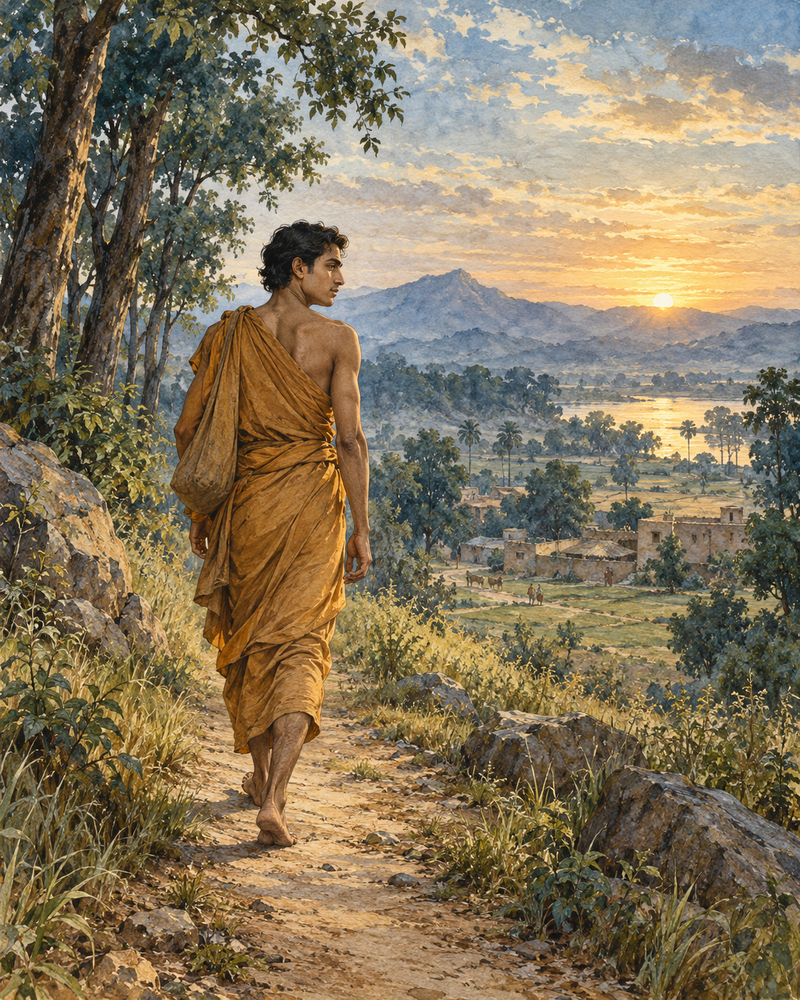

# 01. The Search No Teacher Could Finish

Before he became a teacher, Gotama had to learn how to leave a teacher.

He had already left his family. In the account he would later give, his parents wept as he cut his hair and beard, put on the robe of a wanderer and went into homelessness. He was young; the strength of youth was still with him. Yet youth could not answer the question that troubled him. Everything he might gather around himself was subject to change. People he loved would grow old. His own body would fall ill. What sort of safety could be built entirely from things that could not remain?

The roads of northern India carried other seekers. Some learned difficult disciplines; some pursued knowledge through meditation and debate. Gotama entered this world neither as an enemy of its teachers nor as someone already possessing the answers. He went to Alara Kalama and asked to learn.

He listened. He practised. The teaching was something to be tested in experience, not merely repeated from memory. In time he attained the meditative state associated with that school: the sphere of nothingness. Alara recognised his achievement. The student need no longer sit beneath the teacher; they could guide the community together.

For a homeless young man, it was a remarkable offer. Here were respect, companionship and a place in which his abilities were understood. Nothing in the account suggests that Alara mocked him or withheld knowledge. The offer was generous. Refusing it required no accusation against the person who made it.

But Gotama examined what he had attained. This refinement of consciousness was extraordinary, yet it was not the freedom he sought. It did not bring the final ending of the conditions that sustain suffering. He could not make it sufficient by being grateful for it. So he left.

Another community brought another attainment. With Uddaka Ramaputta he learned the discipline associated with Rama, reaching the sphere of neither perception nor non-perception. Once again his capacity was acknowledged. Once again leadership was placed within reach. He had come as a learner, and now the community could be entrusted to him.

The dilemma had become more difficult precisely because he had succeeded. Failure can send a person onwards with little hesitation. Success asks a subtler question: whether one is willing to stop searching because other people are satisfied with what one has become.

Gotama did not stay. The teaching had taken him far, but not to the end of his inquiry. He continued towards Uruvela, where he found a place suitable for striving: a pleasant stretch of country, a clear river and nearby villages where food could be obtained. Such ordinary necessities mattered. A search for liberation still unfolded in a body that needed shelter and nourishment.

He had gained knowledge from both communities. He did not need to erase that debt in order to recognise its limits. Nor could another person's confidence complete the work that remained his own.

The river at Uruvela offered no certificate of arrival. There was ground on which to sit, water moving through the landscape and the unfinished question that had brought him from home. He settled there, prepared to begin again.

## Wisdom to Remember

Gratitude for a teacher can coexist with an honest recognition that the search is unfinished.

## A Reflection for Today

Consider a goal you have inherited from other people. Does achieving it meet the need that first made you pursue it? You can value what a school, mentor or profession has given you while reassessing your next step.

## Source Note

Original literary retelling of MN 26, *Ariyapariyesana Sutta*, Pali Canon; Theravada textual transmission. [Primary text and translation](https://suttacentral.net/mn26/en/sujato). Classification: canonical teaching narrative, not an independently verified historical transcript. No dialogue here is a verbatim canonical quotation. Scene-setting and interpretive transitions are original editorial reconstruction. This episode follows the early discourse rather than the later palace-escape biography. MN 26 does not name a horse, charioteer or sleeping palace household. The attainment taught by Uddaka is associated in the text with Rama.
