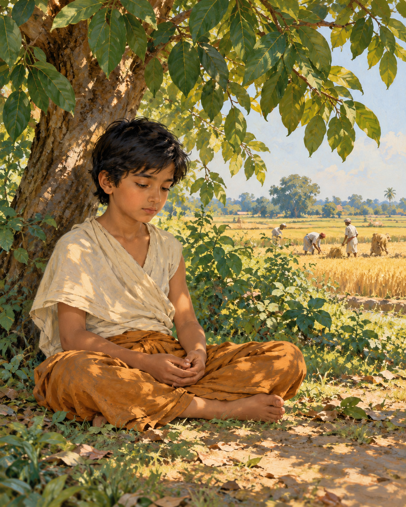

# 02. The Shade He Remembered

His body had become a record of everything he had refused it.

Gotama had reduced his food until the strength drained from his limbs. His skin clung tightly to his frame. When he touched his belly, the bones of his back seemed close beneath his hand. The austerities were not a passing experiment. He had committed himself to them with a determination so fierce that pain itself could appear to prove his sincerity.

There were other practices too: forceful efforts to subdue the mind and painful attempts to restrain the breath. He endured what the discourse describes in stark physical detail. Yet endurance was not awakening. He could survive an ordeal and still be bound by the confusion he had set out to end.

Five ascetics attended him. They expected that if anyone could discover the truth through such exertion, this relentless seeker would do so. Their presence gave the experiment a human weight. To change course would mean disappointing those who believed in him, not merely revising a private theory.

At the edge of his strength, another possibility returned through memory.

He remembered being young, seated beneath a rose-apple tree while his father was working. Away from the activity, his mind had entered a collected, joyful state, secluded from sensual pleasures and unwholesome qualities. The recollection did not offer another way to punish himself. It suggested that a certain kind of happiness might belong to the path.

That was the difficult discovery. He had treated pleasure as something to fear because desire so readily fastens upon it. But the remembered joy did not depend on possession or indulgence. Might he have been rejecting a helpful condition simply because it did not hurt?

He recognised this possibility as the way towards awakening. Then came a practical admission: a body so depleted could not sustain the work. The mind did not need a victim. It needed the support of sufficient food.

He began to eat solid nourishment again, including rice and porridge. The five companions saw what he was doing and lost their confidence. To them, he appeared to have abandoned the struggle. They left him.

From outside, the change could look like collapse. The man who had outlasted others in hardship now accepted food. Yet the deeper surrender had been his willingness to stop protecting a failed method. He no longer needed suffering to stand as evidence that he was serious.

As strength returned, he developed the collected states of meditation. The remembered shade became more than a lovely episode from childhood; it had corrected the direction of his effort. He pursued clarity without deliberately injuring the body that made practice possible.

The discourse carries the account onwards through the night of awakening. It describes knowledge of former lives, knowledge of beings passing according to their actions and, finally, the ending of the taints that sustain bondage. These are the tradition's claims about liberation, not the rewards of starvation.

At the turning point of the story stands no public triumph. There is a memory, an honest judgement and the acceptance of food. The decisive courage is almost quiet enough to miss: after going so far in one direction, he was willing to turn.

## Wisdom to Remember

An effort is not wise simply because it is painful. Practice must be judged by where it leads.

## A Reflection for Today

Notice one place where you confuse exhaustion with commitment. Adequate food, rest and medical care can support serious work. This story concerns an extreme ascetic experiment; it is not advice to undertake fasting or breath restriction.

## Source Note

Original literary retelling of MN 36, *Mahasaccaka Sutta*, Pali Canon; Theravada textual transmission. [Primary text and translation](https://suttacentral.net/mn36/en/sujato). Classification: canonical teaching narrative, not an independently verified historical transcript. No dialogue here is a verbatim canonical quotation. Scene-setting and interpretive transitions are original editorial reconstruction. The childhood tree here is a rose-apple tree, not the Bodhi tree. This discourse describes the return to food but does not identify Sujata or narrate her milk-rice offering; those familiar details belong to other biographical traditions.
