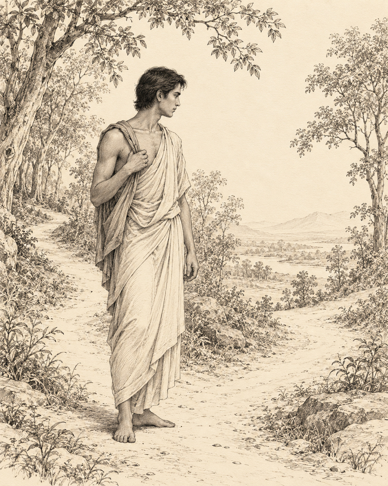

# 03. The Cowherd of the Mind

Long before he taught others to observe the mind, Gotama watched his own thoughts arrive.

Solitude did not guarantee that every thought would be peaceful. A person could sit away from a village and still carry a crowded world within: pleasures imagined and pursued, resentment revisited, impulses that made another being's pain seem unimportant. Distance from noise was useful, but it could not do the work of understanding.

Before awakening, he made a distinction. On one side he placed thoughts of sensual desire, ill will and harming. On the other he placed thoughts of renunciation, goodwill and harmlessness. It was a plain division, concerned with the direction in which thinking carried him.

When a thought from the first group appeared, he examined its consequences. Would following it injure him? Would it injure someone else? Would it injure both? Did it help understanding, or crowd understanding out? By seeing the damage towards which it tended, he weakened its claim on his attention.

He did not need to turn the arrival of a thought into a verdict on his entire character. The work concerned what happened next. A thought could be recognised without being entertained, much as a traveller might notice a side road without taking it.

Later, when describing this training, he used an image from the fields. During the season when crops stood ready, a cowherd had to keep cattle from wandering into them. Carelessness could bring punishment or a fine. The danger was practical and visible: an animal's appetite could destroy another household's food.

So the cowherd stayed alert. There was a boundary to maintain. In the same way, Gotama understood the cost of unwholesome thinking and checked it before it spread through speech and action. A private resentment did not remain harmless merely because no one else could hear it.

But constant guarding was not the whole story. Thoughts of renunciation, goodwill and harmlessness caused neither his own affliction nor that of others. They opened room for understanding. He could allow them without the same fear of damage.

Here the picture changed. After the harvest, when the crops had been brought in, a cowherd could sit under a tree or in the open and remain aware of the cattle. The watchfulness continued, but its strain eased. There was no standing grain to protect from every wandering mouth.

Even wholesome thinking had a limit. If he kept thinking and examining without rest, the body could tire, and a tired body could unsettle the mind. Recognising this, he steadied attention. Good intentions were allowed to mature into collectedness rather than becoming an endless conversation with himself.

There was discipline in both movements: turning away from what led towards harm, and knowing when useful thought had done its work. The aim was not to fill every moment with virtuous sentences. It was to free the mind for a deeper seeing.

The field image leaves us with a patient figure whose attention changes as conditions change. Sometimes he must intervene; sometimes he can simply watch. He does not abandon the animals, and he does not drive them ceaselessly merely to prove that he is in charge. Care has become more exact than force.

## Wisdom to Remember

What we repeatedly entertain becomes easier for the mind to follow.

## A Reflection for Today

Choose one recurring thought and examine its likely effects before arguing about whether it is justified. If it feeds cruelty or resentment, redirect attention towards a specific harmless action. When reflection becomes tiring repetition, pause and let attention settle.

## Source Note

Original literary retelling of MN 19, *Dvedhavitakka Sutta*, Pali Canon; Theravada textual transmission. [Primary text and translation](https://suttacentral.net/mn19/en/sujato). Classification: canonical teaching narrative, not an independently verified historical transcript. No dialogue here is a verbatim canonical quotation. Scene-setting and interpretive transitions are original editorial reconstruction. The cowherds are similes used in the discourse, not witnesses to a documented encounter. This retelling combines the teaching and its field imagery without claiming a literal meeting between Gotama and a cowherd.
