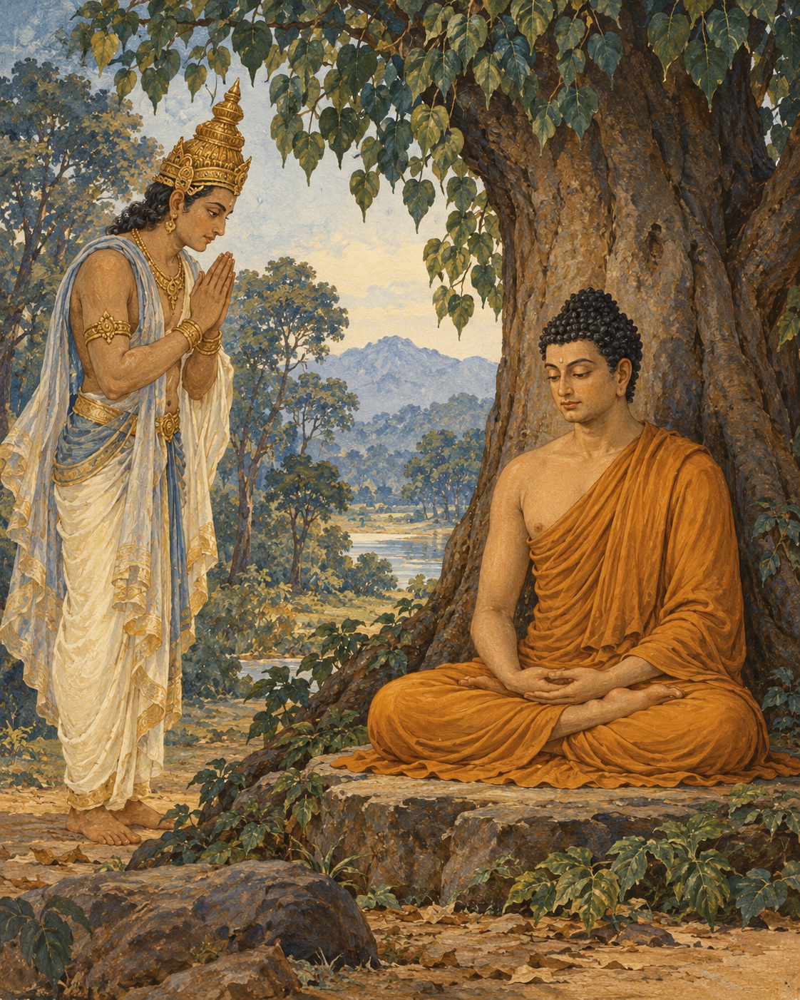

# 05. The Lotuses Not Yet Open

The teaching almost remained unspoken.

In the sacred narrative, the Buddha had awakened and was staying beside the Neranjara River, beneath the Goatherd's Banyan. What he had realised was peaceful and profound. Yet understanding it had required more than cleverness, and communicating it would require more than finding agreeable words.

He considered the world into which he might speak. People delighted in what they could hold, protect and call their own. A teaching about the arising of things through conditions, and the release found through ending craving, would run against those habits. Someone might listen attentively and still hear only another way to acquire what they wanted.

If he taught and was not understood, the effort would be burdensome. His inclination turned towards remaining at ease rather than undertaking it.

Here the discourse opens beyond the human world. Brahma Sahampati, a celestial being, perceives this thought. To him, the possibility that the awakened Buddha might remain silent is a calamity. He appears before the Buddha, arranges his robe respectfully and kneels with joined hands.

His appeal does not deny that teaching will be difficult. It asks the Buddha to see the people for whom the difficulty need not be final. Some are less obscured than others. Without an opportunity to hear, even those capable of understanding may be left without the help they need.

Brahma's presence belongs to the religious world of the text. He is not a messenger whom an archive can place on a dated road. Within the narrative, a celestial being bows to awakened wisdom and asks that it enter the sorrowing world. The scale is cosmic; the appeal is intimate. There may be someone who can understand.

The Buddha surveys living beings with compassion. They are not all alike. Their capacities differ, and so do the obstacles before them. Some are receptive; others are difficult to teach. He sees neither a universally hopeless humanity nor a world already prepared to agree with him.

The discourse offers the image of a lotus pond. Some flowers are still held beneath the water. Some have reached its surface. Others have risen clear. All have grown in the same element, but they do not occupy the same place within it.

One could look across such a pond and notice only the water. One could mistake the unopened flowers for flowers that would never open. The image allows a more patient judgement: what is not visible in full may still be developing.

The Buddha accepts the invitation to teach. He makes the possibility of hearing available to those who are willing to listen. Brahma recognises that his request has been answered, pays his respects and disappears from the scene.

The change is not that the teaching has suddenly become easy. The obstacles remain. Human attachment has not vanished, and no promise is made that every listener will understand. What changes is the willingness to speak into that uncertainty.

The pond holds flowers at many stages. Compassion does not wait until every one of them has reached the light. It attends to the possibility already present among them, including the possibility that would otherwise remain unseen.

## Wisdom to Remember

Compassion notices capacities that discouragement can overlook.

## A Reflection for Today

When explaining something valuable, consider who may be ready to hear one small part of it. Offer that part clearly and without pressure. Neither silence born of discouragement nor a demand for immediate agreement serves every listener.

## Source Note

Original literary retelling of SN 6.1, *Brahmayacana Sutta (The Request of Brahma)*, Pali Canon; Theravada textual transmission. [Primary text and translation](https://suttacentral.net/sn6.1/en/sujato). Classification: canonical teaching narrative, not an independently verified historical transcript. No dialogue here is a verbatim canonical quotation. Scene-setting and interpretive transitions are original editorial reconstruction. This is a canonical supernatural narrative. Brahma Sahampati is a celestial figure in Buddhist cosmology, not the historical Buddha or a creator being endorsed as supreme. The lotus imagery belongs to the discourse; its interpretive expansion is editorial.
