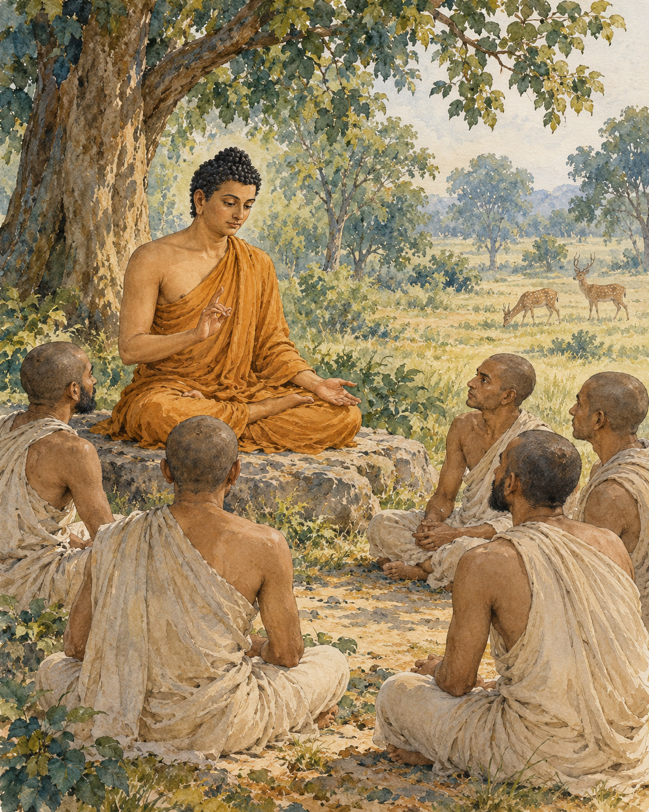

# 06. A Way Between the Extremes

Five listeners sat before a teaching that would ask them to reconsider suffering itself.

The place was Isipatana, near Varanasi, in the Deer Park. The discourse remembers the Buddha addressing the group of five monks there. It does not begin with a promise that their lives would become pleasant if only they believed him. It begins by setting aside two ways of seeking release that fail to reach their aim.

One way pursues satisfaction through sensual indulgence. The other deliberately inflicts pain upon the body. The Buddha named both as extremes to be avoided by someone who had gone forth. A person could spend a life moving between them, looking for freedom first in gratification and then in punishment.

The way he taught required a different discipline. It included understanding and intention, speech and action, livelihood and effort, mindfulness and concentration. These eight factors formed a path to be cultivated. The middle way was not a vague preference for doing everything moderately; it was a training with direction and substance.

Then he turned to dukkha: the suffering and unsatisfactoriness bound up with clinging. Birth, ageing and death belonged to this account. So did separation from what was loved, contact with what was unwelcome and the frustration of not obtaining what was wanted. These were not accusations against human beings for feeling pain. They were experiences to be understood.

The next movement concerned the origin of suffering. Craving reached out towards pleasure, towards becoming, even towards non-becoming. It could fasten on one experience and then another, searching restlessly for something that would finally satisfy its demand.

But the account did not end with that restlessness. The cessation of craving was possible. There was release from its compulsive reach. And there was a way of practice leading towards that cessation: the same eightfold path he had introduced.

Each truth carried a task. Suffering was to be understood. Its origin was to be abandoned. Cessation was to be realised. The path was to be developed. Merely repeating four statements would not fulfil those tasks, any more than naming a road would carry a traveller along it.

The Buddha described his own understanding in relation to these responsibilities. He did not claim complete awakening until his knowledge of the truths, their tasks and their fulfilment was clear. The teaching asked for work because it arose from work already brought to completion.

As the five listened, Kondanna saw something decisive. Whatever comes into being is subject to ending. This was more than a prediction that pleasant moments would eventually fade. In the discourse it marks the arising of the Dhamma eye, an initial breakthrough in understanding.

The narrative then widens. Celestial beings announce that the wheel of the teaching has been set in motion. The announcement travels through the heavens; the world trembles and a great light appears. These are the sacred text's expressions of the event's significance.

At its human centre remain a teacher and five listeners. A path has been described, and one listener has begun to see. The suffering they knew has not been concealed beneath a consoling story. It has become something that can be met, understood and worked with.

## Wisdom to Remember

The Four Noble Truths invite four kinds of work, not merely four beliefs.

## A Reflection for Today

With a small current difficulty, distinguish the discomfort itself from the craving that may intensify it. Then choose one path factor to practise: honest speech, a harmless action or a few minutes of steady attention. Avoid blaming yourself for pain.

## Source Note

Original literary retelling of SN 56.11, *Dhammacakkappavattana Sutta*, Pali Canon; Theravada textual transmission. [Primary text and translation](https://suttacentral.net/sn56.11/en/sujato). Classification: canonical teaching narrative, not an independently verified historical transcript. No dialogue here is a verbatim canonical quotation. Scene-setting and interpretive transitions are original editorial reconstruction. Tradition identifies this as the first discourse. The celestial proclamation, earthquake and radiance are canonical sacred motifs, not independently established historical observations. Dukkha has a wider range than a single English equivalent can convey.
