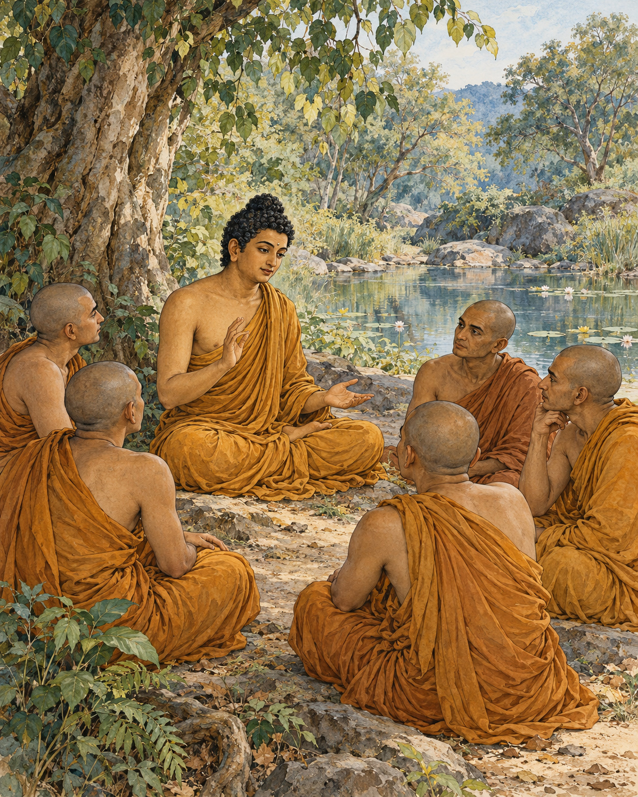

# 07. What the Hand Cannot Hold

The body did not obey simply because someone called it mine.

At Isipatana, the Buddha addressed the five monks again. He directed their attention towards the very things people most readily take to be themselves: the body, feeling, perception, the formations of mind and consciousness. The teaching did not ask them to look for an unfamiliar object somewhere beyond experience. It asked them to examine what they were already depending on.

He began with form, the material body. If it were a self under complete command, it would not bring affliction. A person could decide exactly how it should be and make it so. Yet the body could become painful or unwell despite the urgency of the wish that it should not.

The same inquiry reached into feeling. Pleasure arose and changed. Pain arrived without permission. Neither could be made permanently obedient by insistence. Perception, which recognised and named the world, was also changing. Mental formations and consciousness likewise failed to provide the unalterable authority that possession seemed to promise.

The monks were not being instructed to despise these processes. A body could be cared for; a feeling could be known. But caring and knowing were different from finding an enduring, sovereign self within them.

The Buddha questioned them about permanence. Was the body lasting or subject to change? What about feeling, perception, formations and consciousness? They recognised impermanence in each. Whatever changed could not provide the secure foundation that clinging demanded of it.

The inquiry repeated itself, moving through the five groups. Its patience mattered. An idea about impermanence might be easy to accept while a particular pain, memory or opinion remained fiercely defended as the centre of oneself. The teaching left no single favoured corner unexamined.

It reached beyond the immediate moment. Past, future and present; internal and external; coarse and subtle; near and far: no form of these changing processes was to be exempted merely because it felt precious, impressive or intimate. The habit of identification was being questioned at its roots.

This was not an invitation to conclude that nothing mattered. The discourse described a release from the passion that appropriates experience. When a person no longer demands an unchanging self from what changes, that demand no longer has to be defended against every movement of life.

The five monks listened. The narrative records their minds becoming liberated from the taints through the ending of clinging. It presents this as complete release, not a brief spell of relaxation or an improved opinion of themselves.

For a modern reader, the full claim may be difficult to enter at once. The scene still asks a precise question. When something changes in body or mind, must every change become a threat to the owner we imagine standing behind it? The ancient inquiry does not settle for an encouraging answer. It asks for careful seeing.

In the grove, there was no object to carry away as proof of success. The release described was from appropriation itself. What had been treated as an unquestionable possession could be known as a changing process. The hand that demanded permanence no longer had to close around it.

## Wisdom to Remember

Changing experience cannot provide an unchanging possession or a self under complete control.

## A Reflection for Today

When a mood arises, try describing it as an experience rather than your whole identity: sadness is present, or anxiety is present. This modest exercise does not exhaust the teaching of not-self. It can help create room for care without turning every mood into a definition of who you are.

## Source Note

Original literary retelling of SN 22.59, *Anattalakkhana Sutta*, Pali Canon; Theravada textual transmission. [Primary text and translation](https://suttacentral.net/sn22.59/en/sujato). Classification: canonical teaching narrative, not an independently verified historical transcript. No dialogue here is a verbatim canonical quotation. Scene-setting and interpretive transitions are original editorial reconstruction. The five groups are the aggregates: form, feeling, perception, formations and consciousness. Not-self is a subtle Buddhist teaching, not a claim that persons do not matter or that suffering should be ignored. This retelling avoids presenting a disputed metaphysical slogan as the whole doctrine.
