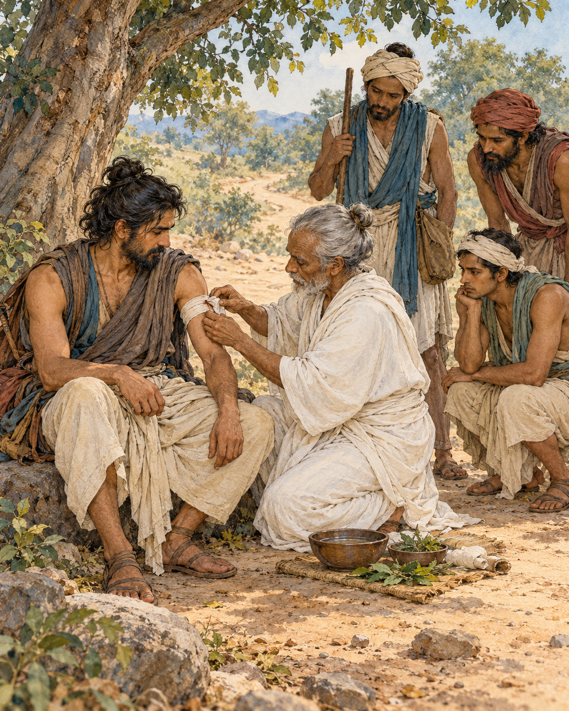

# 09. The Question That Could Wait

Malunkyaputta had decided that his unanswered questions could no longer wait.

Alone in meditation, the monk had been thinking about matters the Buddha had left undeclared. Was the world eternal or not? Was it limited or limitless? What was the relationship between life and body? What could properly be said of an awakened one after death? The questions had gathered force until he made his training conditional upon receiving answers.

He would ask the Buddha directly. If the answers were given, he would remain in the spiritual life. If they were not, he would leave.

That evening he approached the Buddha, paid his respects and explained his position. He did not ask timidly. If the Buddha knew, he should declare what he knew. If he did not know, Malunkyaputta thought, an admission of ignorance would be straightforward.

The Buddha first examined the agreement the monk believed existed between them. Had he promised Malunkyaputta answers to those questions as a condition of entering the training? Had Malunkyaputta entered upon such an understanding? No such promise had been made.

Then the Buddha offered a picture whose urgency left little room for abstraction.

A man had been struck by a poisoned arrow. His companions brought a surgeon to help him. But before allowing the arrow to be removed, the wounded man demanded information. Who had shot it? What was the attacker's social standing, name and appearance? Where did he live? What kind of bow had been used? What were the arrow and its fittings made from?

The questions multiplied. Each answer could seem to justify another question, and each further question delayed the work for which the surgeon had come. The wounded man made complete information a condition of accepting treatment.

He would die before that condition was fulfilled.

The Buddha did not describe an actual patient whom Malunkyaputta could visit. He made the danger of misplaced conditions visible through a parable. The essential work could be postponed indefinitely by demanding that a different kind of inquiry be finished first.

Whether one adopted this view of the cosmos or that, birth, ageing, death, sorrow and distress still required attention. The Buddha taught a way towards their ending. The matters he had left undeclared did not lead to the goal of that training; the Four Noble Truths did. He distinguished the questions according to their role in liberation.

For Malunkyaputta, this shifted the ground beneath the ultimatum. His teacher had not offered to answer every conceivable question. He had offered a path addressing suffering and its cessation. Leaving that path would not, by itself, settle the questions that had unsettled him.

The discourse ends with Malunkyaputta receiving the teaching gladly. It records no final inventory of his private doubts, and there is no need to invent one. He had been shown a distinction on which he could act.

The surgeon in the parable still stands beside the wounded man, ready to do something useful. The unanswered questions remain unanswered. Yet one decision has become clearer: the arrow need not stay in the wound while the mind negotiates with the whole universe.

## Wisdom to Remember

An unanswered question need not prevent the useful action that is already available.

## A Reflection for Today

Ask whether a question must be settled before you can take the next helpful step. Some uncertainty requires investigation; some can coexist with action. In a health emergency, seek urgent care rather than using this parable as a substitute for medical judgement.

## Source Note

Original literary retelling of MN 63, *Culamalunkyovada Sutta*, Pali Canon; Theravada textual transmission. [Primary text and translation](https://suttacentral.net/mn63/en/sujato). Classification: canonical teaching narrative, not an independently verified historical transcript. No dialogue here is a verbatim canonical quotation. Scene-setting and interpretive transitions are original editorial reconstruction. The poisoned-arrow episode is an explicit parable, not a biographical event. The discourse distinguishes a particular set of speculative views from teachings directed towards liberation; it is not a rejection of science, curiosity or all philosophical inquiry.
