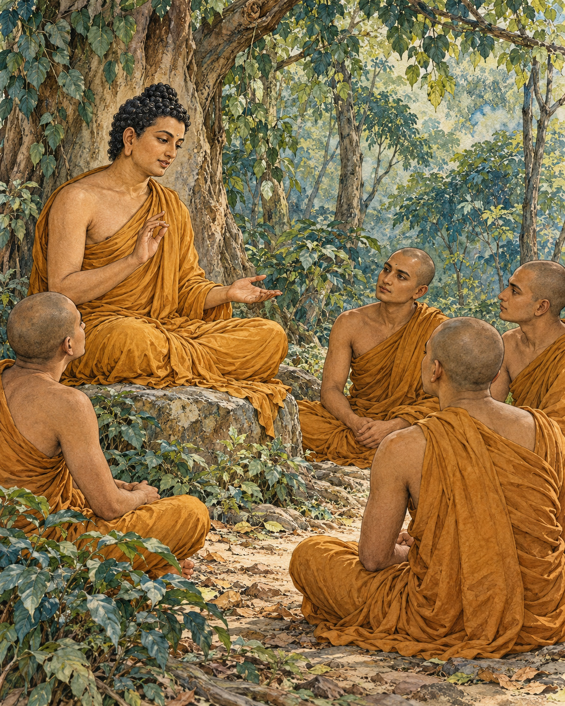

# 10. A Calmness Put to the Test

Everyone seemed to know that Vedehika was a gentle woman.

In the teaching story the Buddha told, her reputation had spread through Savatthi. People praised her composure and good temper. From outside the household, there appeared to be little reason to doubt them. The work was done, the household ran smoothly and its mistress had no visible occasion to lose control.

Kali, the enslaved woman who performed that work, wondered what the reputation really meant. She was capable and diligent. Was Vedehika free from anger, or did anger simply have no need to show itself while everything happened as she wished?

Kali decided to test the difference. One morning she rose later than usual.

Vedehika called to her and demanded an explanation. Kali offered none that would excuse the delay. The mistress frowned, displeased. The celebrated calm had already begun to narrow around a small inconvenience.

On another morning Kali rose later still. Again Vedehika questioned her. Again the answer brought no relief to the mistress's anger. What had first appeared in a look now found its way into grumbling. Kali's suspicion grew stronger: the anger had been present, waiting for conditions that would expose it.

The test continued. Vedehika's response became violent. She seized a bar and struck Kali on the head, causing an injury. The story's reversal was complete. A household praised for the gentleness of its mistress had become a place where a person under her power was harmed.

Kali went to the neighbours and showed what had happened. Vedehika's reputation changed. The calm woman was now spoken of as cruel and quick-tempered. What the neighbourhood had admired had depended upon a servant's constant efficiency and submission.

The Buddha directed the lesson towards the monks listening to him. A monk might appear agreeable while other people spoke pleasantly and his material needs were well supplied. Such ease did not yet show how he would meet correction or an unwelcome word. The training had to reach the point where circumstances stopped cooperating.

He described the many ways speech could arrive: at a suitable or unsuitable time, truthfully or falsely, kindly or harshly, helpfully or otherwise, with goodwill or hostility. The task was to prevent another person's speech from becoming the occasion for hatred in one's own mind.

The discourse developed this demand through powerful comparisons and, finally, the extreme simile that gives it its name. Even under a brutal attack with a saw, the monks were instructed to guard against hatred. This was a radical standard for their inner training, not a report of an attack that had happened to them.

Kali's story keeps the teaching from becoming merely an attractive ideal. It places a vulnerable person in the path of someone else's unexamined anger. The consequence is injury, not simply a loss of spiritual poise.

Vedehika's good name could not protect Kali. Only a different response in the moment of frustration could have done that. A reputation for gentleness, however widely repeated, was no substitute for the difficult practice of becoming gentle when another person no longer pleased her.

## Wisdom to Remember

Patience becomes visible when convenience and agreement fall away.

## A Reflection for Today

Notice how you respond when someone with less power inconveniences you. Pause before speaking or acting. Non-hatred does not require remaining available for abuse: leave danger, protect vulnerable people and seek support when needed. Do not test another person through deliberate provocation.

## Source Note

Original literary retelling of MN 21, *Kakacupama Sutta*, Pali Canon; Theravada textual transmission. [Primary text and translation](https://suttacentral.net/mn21/en/sujato). Classification: canonical teaching narrative, not an independently verified historical transcript. No dialogue here is a verbatim canonical quotation. Scene-setting and interpretive transitions are original editorial reconstruction. Vedehika and Kali appear within a teaching story; they are not independently established historical persons. Kali is enslaved, not a freely employed servant. The story exposes abusive power and does not endorse slavery or blame its victim. The saw is an extreme hypothetical simile for monastic mental training, not an instruction to submit to violence.
