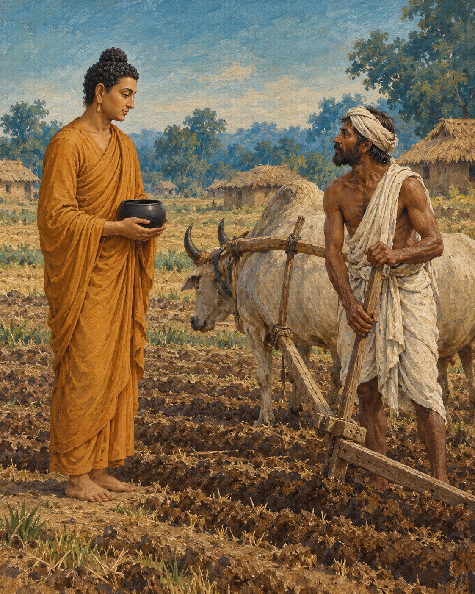

# 13. Seeds in an Unseen Field

Sowing time made work visible everywhere. The fields around Ekanala in Magadha were being prepared, and the brahmin Kasi Bharadvaja had a great number of ploughs at work. The livelihood of many people depended on seed meeting soil at the proper season.

The Buddha arrived while food was being distributed. Wearing his robes and carrying his bowl, he stood aside for alms. To the farmer, the contrast seemed plain: some people laboured, while this mendicant waited to be fed.

Bharadvaja challenged him. He himself ploughed and sowed before eating. Why should the ascetic not do the same?

It was a question with the weight of ordinary fairness behind it. Food did not spring into bowls without somebody's effort. The farmer knew the equipment, labour and risk that stood between an empty field and a harvest. Looking at the visitor, he saw no plough and no oxen.

The Buddha answered through the farmer's own craft. He too cultivated, he explained, although the work could not be inspected by looking for a yoke upon his shoulder.

His description gave the tools familiar inward counterparts. Confidence began the work like seed. Discipline nourished it like rain. Understanding and mindfulness made the work accurate. Truth helped clear what should not be growing. Energy carried the practice forward towards release from suffering.

The image did not erase the farmer's knowledge. It depended on it. Anyone who had struggled with a field understood that wishing was insufficient. A harvest asked for repeated attention, appropriate tools and persistence when the work was tiring. Inner cultivation required no less seriousness.

Bharadvaja's response changed. He recognised that the man before him was speaking of labour with a different object, and offered him a generous bowl of milk-rice. A moment earlier he had questioned whether the visitor deserved food at all. Now he wished to honour him.

But the Buddha did not accept this particular offering. Food obtained as a reward for reciting verses, he explained, was not the way he lived. Teaching was not to become a performance purchased by a meal. He directed the farmer to make an offering in another way.

Then comes the story’s marvel. When the milk-rice is disposed of as instructed, it hisses and steams in the water, as though something fiercely heated had been plunged into it. The farmer watches in astonishment. Approaching the Buddha once more, he bows down, expresses his confidence in the teaching and asks to become a monk. The encounter that began with a challenge about earning a meal has become a request for an entirely different way of living.

The human turn, however, remains intelligible. A man who first measured effort by the presence of farming implements had been invited to notice another kind of work. The invitation did not belittle his skill. It enlarged his understanding of what effort might accomplish.

Bharadvaja went on to practise earnestly and, the discourse tells us, attain liberation. He did not merely admire an elegant comparison. He entered the field of his own conduct and began to tend it.

Outside, sowing season would still demand seed, rain and capable hands. Within, another cultivation had become possible: steady attention to the habits from which suffering grows, and patient labour towards a harvest no granary could contain.

## Wisdom to Remember

The mind also needs cultivation; intention becomes fruitful through sustained care.

## A Reflection for Today

Choose one inward task for the week: truthful speech, patient listening, or noticing resentment before acting. Treat it as regular work. Look for a small change in conduct rather than an impressive spiritual experience.

## Source Note

Original literary retelling of Kasi Bhāradvāja Sutta, SN 7.11, preserved in the Pali Canon of the Theravada tradition. Canonical narrative; not an independently verified historical transcript. [Read the source](https://suttacentral.net/sn7.11/en/sujato). No dialogue here is offered as a verbatim quotation. Sensory staging and transitions are literary reconstruction. A parallel is Sutta Nipāta 1.4. The steaming milk-rice is a supernatural canonical motif. The agricultural comparison does not imply that material labour is inferior or unnecessary.
