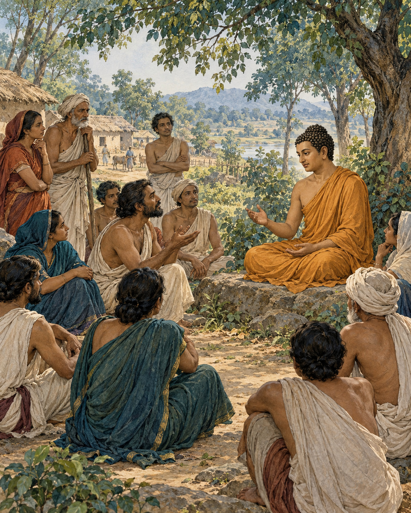

# 14. The Village of Questions

The people of Kesaputta had heard many confident voices. One visiting teacher praised his own doctrine and dismissed the others. Another arrived, equally certain, to reverse the judgement. Each account of truth seemed to come with an account of everyone else's error.

When the Buddha reached their town, the Kalamas came to meet him. They did not all greet him in the same way. Some bowed, some exchanged courtesies, some introduced themselves, and some sat quietly. Even the manner of their arrival allowed room for difference.

Their question was direct. With so many teachers contradicting one another, how could they know whom to trust?

The Buddha did not shame them for uncertainty. In circumstances like these, uncertainty made sense. He also did not demand that his reputation settle the matter. The problem needed a more careful response than replacing one unquestioned authority with another.

He cautioned them against relying solely on what had been repeated, inherited, written down, reasoned out, or accepted because a revered teacher said it. A convincing argument could still serve confusion. A treasured tradition could be misunderstood. Confidence in a speaker did not remove the need to examine what the teaching did to a life.

Then he brought the discussion down from competing systems to recognisable human experience. What happened when greed possessed a person? Did it bring benefit or harm? They could consider what greed made people willing to do: take what was not given, deceive, injure, and encourage others towards the same conduct.

Hatred could be examined in the same way. So could delusion. The Kalamas did not need to settle every question about the universe before recognising that these states could bring suffering. Nor were they asked to make private preference the only judge. They were to consider whether qualities were blameworthy, whether wise people criticised them, and what consequences followed when those qualities were lived out.

The examination also worked in the other direction. Freedom from greed, hatred and delusion made a different manner of living possible. A person not driven by these forces could refrain from harming and could encourage others towards care.

The teaching opened further into goodwill, compassion, appreciative joy and equanimity, extending beyond the small circle of people one happened to favour. The test of a view was no longer merely whether it defeated a rival view. It was also whether the person who held it could inhabit the world with a mind less governed by hostility.

The Buddha described assurances available to such a person, including peace of conscience amid uncertainty about the workings of another life. Ethical practice did not have to wait until every metaphysical dispute had been resolved. There was work to do in the life already being lived.

The Kalamas' questions had not been brushed away. They had been given a direction: examine, learn from the wise, observe effects, and abandon what brings harm. This was more demanding than believing whichever teacher spoke most beautifully. It asked them to become responsible participants in understanding.

At the end of the discourse, they expressed trust in the Buddha and his teaching. The trust had grown through examination rather than through a demand to stop examining. Their town had received another visitor, but this meeting offered something quieter than another contest of certainty: a way to begin testing the heart.

## Wisdom to Remember

Let understanding grow through honest examination, wise counsel and the consequences of practice.

## A Reflection for Today

Before adopting advice, ask what it encourages you to become. Does it strengthen greed, resentment or confusion? Seek informed criticism as well as confirmation. Personal conviction becomes more reliable when it can withstand careful examination.

## Source Note

Original literary retelling of Kesamutti or Kālāma Sutta, AN 3.65, preserved in the Pali Canon of the Theravada tradition. Canonical narrative; not an independently verified historical transcript. [Read the source](https://suttacentral.net/an3.65/en/sujato). No dialogue here is offered as a verbatim quotation. Sensory staging and transitions are literary reconstruction. Some editions number this AN 3.66. The discourse is not a licence to believe whatever feels right or to reject all expertise; it includes the judgement of the wise and the effects of conduct.
