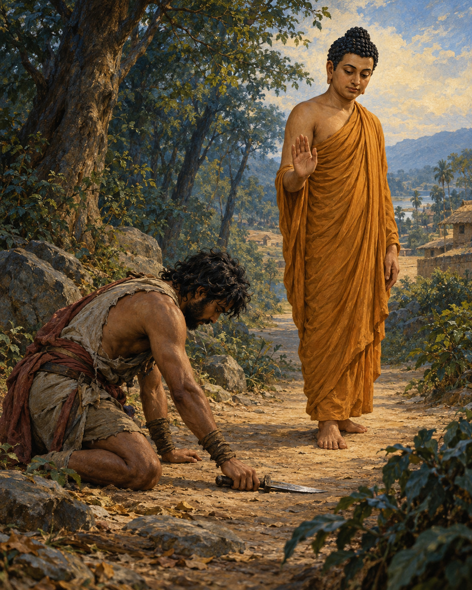

# 16. The Man Who Stopped

Cowherds, shepherds and farmers watched the lone mendicant take the road towards the forest. They called out warnings. Beyond lay the territory of Angulimala. Groups of men had been unable to pass safely; a solitary traveller would seem an easy victim.

The Buddha continued. Behind the name Angulimala stood killings, deserted settlements and fear. People had lost those they loved. The bandit’s name recalled a grisly garland made from his victims, and the road ahead carried the threat of more deaths.

When he saw the Buddha, Angulimala took his weapons and pursued him. What followed is told as a miracle: although the bandit ran at full speed, he could not overtake the Buddha, who walked at an ordinary pace. The distance would not close. Physical strength, on which he had depended, could not deliver the person before him into his power.

At last Angulimala called for the mendicant to stop. The answer turned the command back upon him. The Buddha had stopped harming living beings; the pursuer had not. One man's feet were moving, but violence no longer directed his life. The other had halted on the road while the movement of cruelty continued within him.

Angulimala listened. He threw away his weapons and asked to enter the monastic life. The Buddha admitted him. A person who had made others afraid now undertook a discipline founded on restraint.

The change was startling enough that King Pasenadi, arriving with armed men to deal with the bandit, struggled to recognise the quiet monk before him. The king had expected a danger requiring force. He found a man whose life had been redirected through the Buddha's teaching.

Another meeting revealed a different use for his presence. He saw a woman suffering in childbirth and was moved by her distress. At the Buddha's instruction, he returned with a solemn statement of truth concerning his life since entering the noble discipline: from that beginning, he had not intentionally taken life. The story tells of well-being for the mother and her child after his return.

The distinction mattered. He could not truthfully claim a harmless past. He could speak truthfully about a changed commitment. Compassion did not depend on pretending that the earlier life had never happened.

Through diligent, secluded practice, Angulimala attained liberation, the discourse tells us. Still, the people of Savatthi remembered him. On an alms round, a clod struck his body, then a stone, then a broken piece of pottery. He returned to the Buddha injured, his bowl broken and his robe torn. The Buddha urged him to endure, explaining his suffering in terms of the consequences of past actions.

The robe had not restored those who had died. Nor had his change obliged the bereaved to forget. Every journey for food now took him unarmed among people who had reason to fear and hate him. He could no longer answer their anger with the violence that had once made him powerful. The discipline he had entered had to reach even this difficult meeting between his present life and the suffering he had caused.

At the turning point on the forest road, stopping meant more than standing still. It meant ceasing to feed the intention that had carried him from one act of harm to another. The weapons could be thrown aside in a moment. The rest of his life had to become the meaning of that gesture.

## Wisdom to Remember

Change begins when harm stops; its sincerity is shown in the life that follows.

## A Reflection for Today

Think of a harmful pattern you can interrupt today. Name a concrete action, accept its consequences, and seek appropriate help or accountability. Forgiveness cannot be demanded from those who were hurt.

## Source Note

Original literary retelling of Aṅgulimāla Sutta, MN 86, preserved in the Pali Canon of the Theravada tradition. Canonical narrative; not an independently verified historical transcript. [Read the source](https://suttacentral.net/mn86/en/sujato). No dialogue here is offered as a verbatim quotation. Sensory staging and transitions are literary reconstruction. The pursuit involves explicit supernatural power; the childbirth blessing is a religious narrative, not medical advice. Later accounts of Angulimala’s childhood and teacher are not included. The retelling does not propose immunity from law or erase victims.
