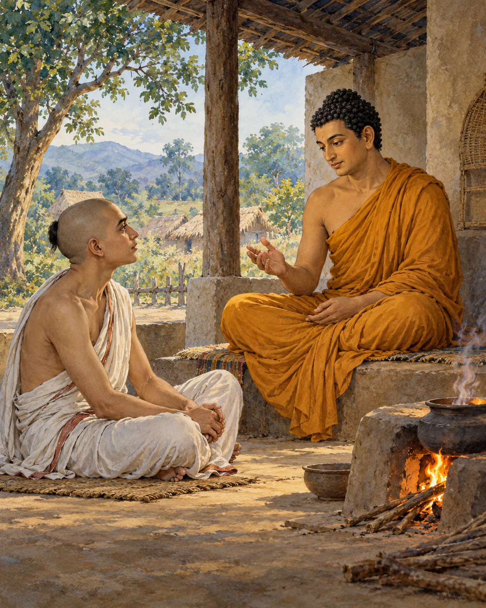

# 17. The Fire That Knows No Caste

Assalayana was sixteen, learned and reluctant. A group of brahmins wanted him to debate the Buddha, who taught that spiritual purity was possible for people of all four social classes. They considered the young scholar capable of challenging that claim.

He knew the scriptures expected of him. He also knew that the Buddha would not be an easy opponent. He tried to decline. The older men urged him again, and eventually he went with a company of brahmins to meet the teacher near Savatthi.

The conversation began courteously. Assalayana stated the position he had been sent to defend: brahmins alone were superior and pure, heirs of a sacred birth that set them above other people.

The Buddha answered with questions rooted in things that could be observed. Brahmin women conceived, gave birth and nursed their children. The ordinary facts of human birth did not disappear beneath a claim of exceptional origin. Why should a declaration of superiority overrule the shared conditions of life?

Assalayana held to the inherited position. The Buddha continued patiently. In some neighbouring societies, social arrangements differed; people could pass between the status of an enslaved person and a master. An order that appeared fixed in one place was not understood everywhere in the same way.

Then came the question of conduct. If a person killed, stole, lied and acted cruelly, would birth protect that person from the consequences? Assalayana could not reasonably reserve moral accountability for the supposedly lower classes. Wrongdoing remained wrongdoing, whoever committed it.

And if someone refrained from harm and cultivated a good life, was that goodness available only to a brahmin? Again, the young scholar acknowledged what the question made plain. People of every class could act well. Members of every class could develop a mind of goodwill.

The Buddha offered an image of fire. Imagine people from different classes kindling flames from different materials. Would a fire made by someone of high birth burn with a special brightness, while another person's fire failed to give heat? The usefulness of the flame did not obey the rank of the hands that kindled it.

A simple physical comparison exposed the strain in the larger argument. If fire could not be made superior by ancestry, why assume that moral and contemplative capacities belonged to ancestry alone? The discussion moved through other examples, repeatedly returning attention from social assertions to the conditions of actual human life.

Assalayana grew quiet. He sat with lowered shoulders and bowed head, unable to sustain his earlier confidence. There is discomfort in that moment. To lose an argument before one's elders can feel like losing the ground beneath one's feet.

The Buddha did not leave him there merely as a defeated boy. The discourse continues with an account about brahmins of the past whose pride was also questioned. Assalayana was being invited into a longer examination, not singled out as uniquely foolish. He eventually expressed trust in the Buddha's teaching.

No society is transformed by a single courteous debate. The inequalities around these men did not vanish when their conversation ended. But something essential had been stated: birth was no substitute for conduct, and no barrier could make compassion the exclusive property of one group.

The young scholar had arrived carrying a claim about who could be pure. He left with a harder and more hopeful possibility: that the worth of a life had to be cultivated, and that the capacity to begin was shared.

## Wisdom to Remember

Human dignity and the capacity for goodness do not depend on inherited rank.

## A Reflection for Today

Notice where a label changes the respect you offer someone: occupation, wealth, accent or family background. In your next encounter, make room for the person beyond the label. Fairness becomes real through ordinary choices.

## Source Note

Original literary retelling of Assalāyana Sutta, MN 93, preserved in the Pali Canon of the Theravada tradition. Canonical narrative; not an independently verified historical transcript. [Read the source](https://suttacentral.net/mn93/en/sujato). No dialogue here is offered as a verbatim quotation. Sensory staging and transitions are literary reconstruction. This is a selected retelling of a longer debate. Ancient four-class terminology does not map neatly onto every later caste system. The fire is a hypothetical comparison, not a hearth literally described at the meeting.
