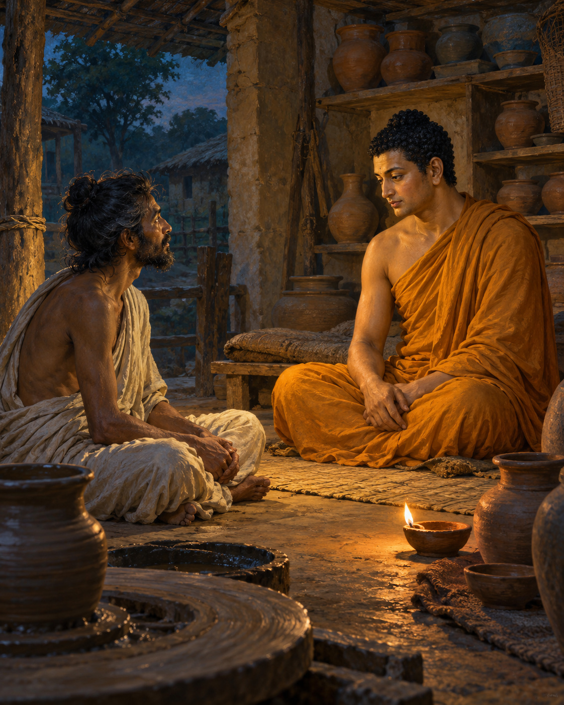

# 18. A Night in the Potter’s Shed

The potter did not offer a palace. He offered space in a shed, with one condition: another wanderer was already staying there, and the newcomer should ask his permission.

The Buddha had come to Rajagaha while travelling through Magadha. He accepted the condition and approached the man inside. The shed was spacious, the other wanderer replied; his guest could stay.

The man was Pukkusati. He had left home out of confidence in the Buddha, whose reputation had reached him, but he had never met the teacher himself. He did not recognise the person now sharing his shelter.

The two settled down to meditation. The Buddha spread grass, sat upright and established mindfulness. Pukkusati also spent much of the night in practice. Nothing in the arrangement demanded ceremony. One traveller had made room for another.

Observing his companion's sincerity, the Buddha began a conversation. For whose sake had Pukkusati left home? Who was his teacher? The wanderer explained his confidence in Gotama, the awakened teacher he hoped to follow. Asked whether he would recognise him, he admitted that he would not.

The Buddha did not first announce his identity. He offered a teaching, and Pukkusati agreed to listen. The night became a lesson in the elements, sensation, awareness and the work of letting go.

The body could be considered through its qualities: solidity, fluidity, heat and motion, along with space and consciousness. What seemed so insistently one's own could be examined as changing conditions. A person did not need to deny experience in order to stop fastening the claim of ownership onto everything that appeared within it.

The teaching was exacting. It moved beyond comfort and beyond a promise of pleasant feeling. Even refined states required understanding. Peace could not be secured by clinging to a delicate experience and insisting that it remain. Wisdom, truthfulness, relinquishment and calm were to be cultivated together.

As Pukkusati listened, recognition came. This was no ordinary fellow wanderer explaining another man's doctrine. The teacher for whom he had left home was sitting beside him. He rose, arranged his robe respectfully and acknowledged the mistake of having addressed the Buddha simply as a companion.

The Buddha accepted the acknowledgement. Pukkusati asked for full ordination. Did he have a complete bowl and set of robes? He did not. He went to obtain the necessary requisites.

While he was searching, a runaway cow killed Pukkusati. The night of understanding was not followed by the long apprenticeship a reader might expect. When the monks later asked about him, the Buddha declared that he had reached the stage of non-returning and would attain final liberation without returning to this world.

The religious assurance belongs to the canonical story. The sudden death keeps the narrative from becoming a promise that spiritual sincerity guarantees ordinary safety. Insight does not bargain away the vulnerability of a human body.

What remains in the shed is a meeting made possible by hospitality. Pukkusati had not recognised a famous face; he had offered room to a stranger and listened carefully. For one night, in a place meant for a potter's work, he encountered the teaching he had travelled to find. The account grants no second evening. That first act of welcome had been enough to let the meeting begin.

## Wisdom to Remember

Attend to what is true before you; wisdom need not arrive in a recognisable form.

## A Reflection for Today

Give someone your full attention without first measuring their status. Listen carefully, while retaining good judgement. Also consider one worthwhile task you have postponed as though time were guaranteed.

## Source Note

Original literary retelling of Dhātuvibhaṅga Sutta, MN 140, preserved in the Pali Canon of the Theravada tradition. Canonical narrative; not an independently verified historical transcript. [Read the source](https://suttacentral.net/mn140/en/sujato). No dialogue here is offered as a verbatim quotation. Sensory staging and transitions are literary reconstruction. Pukkusati’s death and declared spiritual destination are retained from the canonical narrative. Later royal-biographical details are excluded. The six elements are contemplative categories here, not a modern scientific account of matter.
