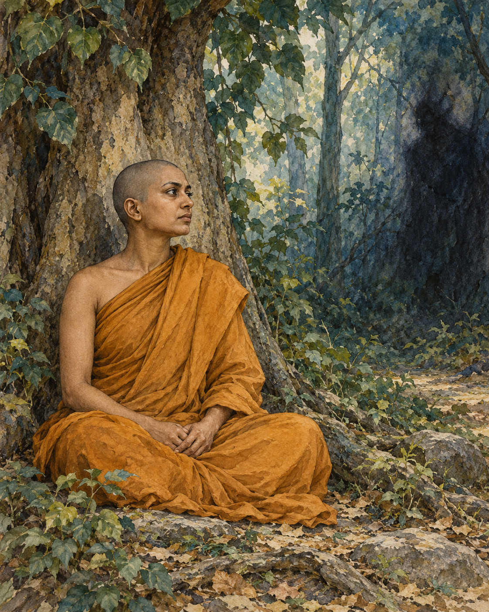

# 19. Soma’s Answer

After her alms round in Savatthi, Soma ate and went to the Blind Men's Grove. She was a bhikkhuni, a woman who had entered the Buddhist monastic life. Beneath a tree she sat down for the day's meditation.

A grove can shelter attention without sealing a person away from difficulty. The world does not become harmless because someone closes her eyes. The story gives the interruption a name and a voice: Mara, the adversary who seeks to disturb liberation.

He approached with a familiar weapon. The state sought by seers was too difficult, he suggested, for a woman of limited understanding. The insult reduced her before considering her practice. Her sex, in his argument, had already decided what she could attain.

The disparagement was meant to enter her meditation and make itself at home. She was to think about her supposed inadequacy instead of attending to the work before her. It would be enough, perhaps, to make her hesitate: to turn a quiet interval of practice into another attempt to justify her right to practise at all.

Soma recognised the interruption. She considered who could be speaking in this way and understood it as Mara's attempt to frighten and unsettle her. Recognition gave her room to answer without taking his measure of her as her own.

Her reply did not ask for a special exception. It questioned the relevance of the insult itself. What did womanhood have to do with a mind well composed, with knowledge established and the teaching understood? The qualities needed for liberation were not replaced by a social judgement about gender.

She went further. A mind fastening itself to the thought of being a woman, a man, or a fixed identity of any kind offered Mara something to seize. In the direction her practice was taking, those claims could be seen rather than obeyed. She did not need to construct a grander image of herself in order to defend against a smaller one.

Mara found that she knew him. Disappointed, he disappeared. The encounter ended without a struggle for the last word. Soma had seen what was being attempted, and the attempt had failed. Her meditation had not required her to make an enemy of the whole world. It had required her to recognise this voice, in this moment, and not yield her understanding to it.

The words had found no foothold. Their promise of certainty—that her birth had already settled her possibilities—could no longer pass for knowledge. She had answered from the qualities being developed in practice: composure, discernment and an understanding that did not need to be granted by the voice opposing her. What he had called impossible was the very work she was doing.

The grove returns, in the reader's imagination, to its ordinary quiet. There is a woman beneath a tree, and there is work she has chosen to do. The judgement brought against her has not defined the reach of that work. In this small canonical scene, wisdom is allowed to speak in her voice, and the voice that tried to silence it has nothing left to add.

## Wisdom to Remember

Another person’s prejudice does not determine the capacity of your mind.

## A Reflection for Today

When you notice an inherited judgement about who can learn, lead or belong, examine it. Support someone’s real opportunity to practise or contribute. If the judgement is directed at you, seek allies as well as inward steadiness.

## Source Note

Original literary retelling of Somā Sutta, SN 5.2, preserved in the Pali Canon of the Theravada tradition. Canonical narrative; not an independently verified historical transcript. [Read the source](https://suttacentral.net/sn5.2/en/sujato). No dialogue here is offered as a verbatim quotation. Sensory staging and transitions are literary reconstruction. Mara’s encounter is a canonical supernatural narrative, not a documented historical event. Reading Mara psychologically is an interpretive option. Soma’s answer concerns liberation and does not erase the material effects of gender discrimination.
