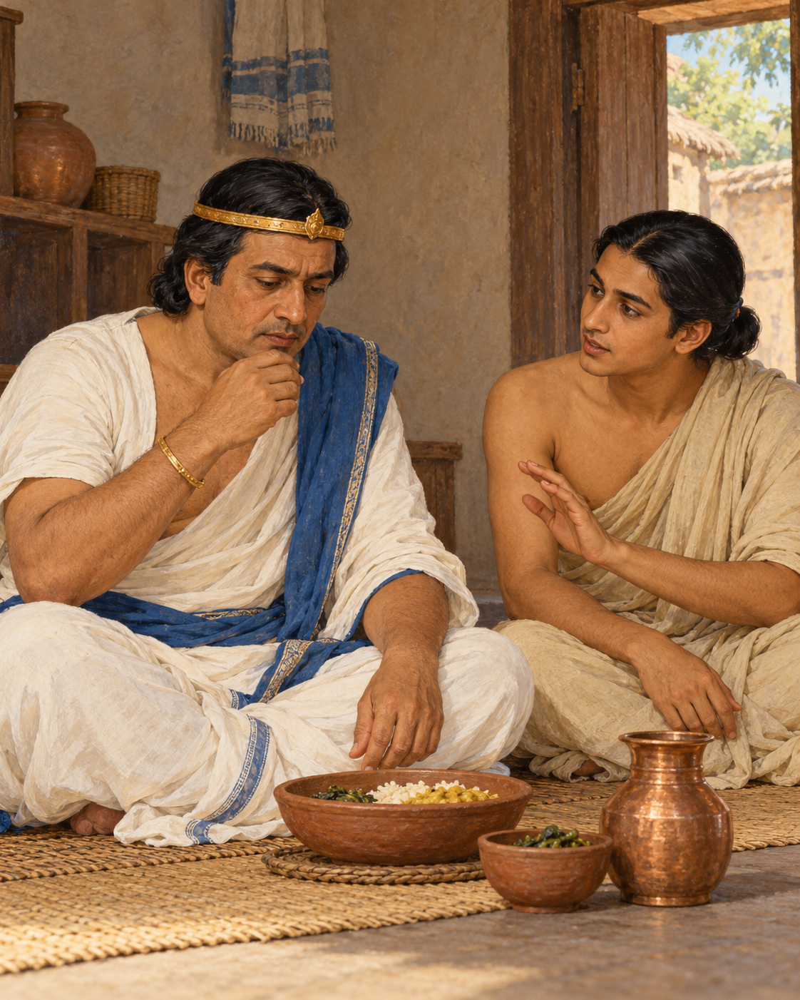

# 20. A King Learns Enough

King Pasenadi had eaten, but the meal had not left him at ease. When he visited the Buddha, he was breathing heavily after a large quantity of food. The encounter began with a body announcing what royal dignity might have preferred to conceal.

A king could command a generous table. He could arrange for dishes to appear, reward those who served him and expect his wishes to be fulfilled. Yet command over a household did not automatically bring understanding of his own appetite. Abundance could become uncomfortable when no clear sense of enough stood beside it.

The Buddha noticed his condition and offered a verse about mindfulness and moderation in eating. The advice connected attention at the meal with a reduction in bodily discomfort and care for life. It gave the king something practical to remember when the next meal arrived.

Sudassana, a young brahmin, was standing behind him. Pasenadi turned to the attendant and asked him to learn the verse from the Buddha, then recite it during the king's meals. He promised a regular payment for the service.

The request had a modest wisdom of its own. An intention formed after discomfort can fade when appetite returns. The king did not rely solely on remembering that afternoon's regret. He placed a reminder where the old habit would happen, and entrusted another person with helping him hear it.

Sudassana learned the verse. At meals, its teaching returned to the king's attention. The repeated reminder met him where a general resolution might have been forgotten: with the food before him and the opportunity to eat more still within reach. The change came by degrees. Pasenadi gradually reduced the amount he ate.

Gradual change matters in this little story. Pasenadi did not display his seriousness by refusing all nourishment. Nor did the Buddha praise a punishing struggle against the body. The direction was towards moderation: receiving food with awareness of what sustained him, rather than allowing availability to decide the measure.

Over time, the account says, the king became more physically comfortable. He touched his limbs and expressed gratitude for the Buddha's concern, recognising benefit in the present life as well as in the spiritual life to come.

It is easy to treat a king's meal as a small subject beside teachings on suffering and liberation. But a day is built out of small occasions. Eating, speaking, resting and taking what is offered are places where intention becomes behaviour. A practice that never reaches those occasions would remain distant from the person attempting to live it.

The king's position also gave the scene a particular gentleness. He was not required to defend the size of his meal or demonstrate that his discomfort was beneath notice. He could hear advice, ask for support and change an ordinary habit. His dignity did not depend on having been wise already.

The food was still there to nourish him. He had learned to receive it with a clearer sense of measure. Sudassana’s small task had helped make that possible: a few remembered words, spoken when the king most needed to remember them.

When Pasenadi later remembered the help he had received, he recognised compassion in something as practical as a reminder at dinner. A teaching had travelled from the Buddha's presence to the table where it was needed. There it became a pause, a choice, and eventually a different way of taking enough.

## Wisdom to Remember

A clear intention becomes stronger when everyday conditions help you remember it.

## A Reflection for Today

Choose one ordinary habit you want to approach with greater care. Place a gentle reminder at the relevant moment and invite suitable support. With food, attend to your individual needs; this story is not medical or dietary guidance.

## Source Note

Original literary retelling of Doṇapāka Sutta, SN 3.13, preserved in the Pali Canon of the Theravada tradition. Canonical narrative; not an independently verified historical transcript. [Read the source](https://suttacentral.net/sn3.13/en/sujato). No dialogue here is offered as a verbatim quotation. Sensory staging and transitions are literary reconstruction. The source identifies Sudassana as a young brahmin; some other tellings call him a prince or substitute Uttara. No exact modern dietary quantity or guaranteed health effect is inferred from the ancient account.
