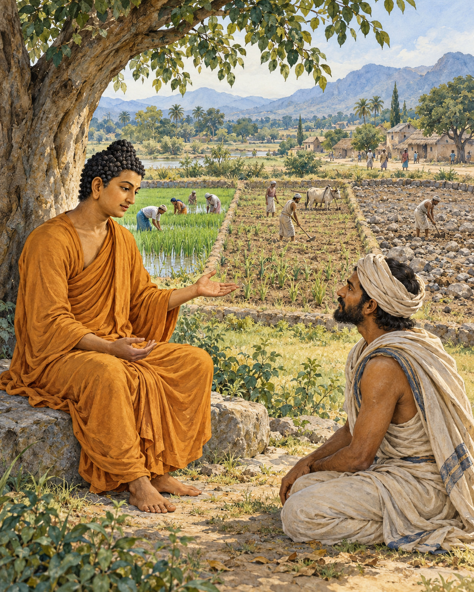

# 21. Fields of Generosity

A chief came to the mango grove with a question that sounded almost like an accusation.

The Buddha was staying near Nalanda, in a grove belonging to Pavarika. Asibandhaka's son approached him, offered the customary greeting, and sat nearby. He wanted to know whether the Buddha truly felt compassion for every living being. When the Buddha affirmed that he did, the chief pressed the difficulty. Why, then, did he teach some people at greater length than others?

It was an uncomfortable question, and a necessary one. Compassion could appear partial when measured by the time a teacher gave to different listeners. A person hearing only a short instruction might reasonably wonder whether those receiving more were also loved more.

The Buddha answered with the work of a farmer. Imagine three fields, he suggested. One has good soil. Another is middling. The third is poor ground, sandy and salty. A farmer has seed to sow and must decide where to begin.

The chief understood such a choice. The best field would be planted first, the average field next. The poor field might be planted afterwards, or might not. Yet even there, something useful could grow: fodder for the animals, if not a harvest for the household.

The Buddha then explained his comparison. The monks and nuns who had committed their lives to the training were like the first field. Lay followers were like the second. Ascetics and religious teachers following other paths were like the third. The image reflected their different relationships to his teaching, rather than a claim that some lives possessed greater worth.

He taught all three groups the whole way of practice, from its beginning through its development to its fulfilment. The monastic and lay followers had taken the teaching as their refuge and would shape their lives around it. For those outside his community, even one sentence understood might contribute to their lasting well-being.

The poor field had not disappeared from the farmer's concern.

Then came another image, closer to the household. Imagine three water jars: one sound and watertight, one whole but porous, and one both porous and cracked. Someone bringing water would fill the vessel best able to hold it before turning to the others.

Again, the chief could see the practical sense. Yet water put into the damaged jar need not be entirely wasted. It might still serve for washing dishes. A vessel did not have to be perfect before it could be of use.

The two comparisons answered the same worry from different directions. Teaching required attention to what a person could receive, remember, and practise. Giving everyone precisely the same explanation would not necessarily give everyone the same help. A long discourse could pass straight through an unwilling listener; a single sentence might remain for years in someone who had seemed unreachable.

The chief had arrived questioning the Buddha's compassion. He left having declared himself a lay follower. The account does not tell us which sentence changed his mind, or whether the fields or the jars stayed with him longer.

It leaves us instead with the teacher's reason for speaking even where understanding seemed least likely. Something might be received. Something might take root. The chance of that small beginning was enough to keep the conversation open.

## Wisdom to Remember

Compassion attends to what each person can receive. A small understanding can still matter greatly.

## A Reflection for Today

When helping someone learn, ask what would be useful now. Offer a manageable beginning rather than measuring generosity only by the amount of advice you give. This principle should never become an excuse to dismiss a learner as permanently incapable.

## Source Note

Original retelling of **SN 42.7, Khettūpama Sutta**, especially sections 1–5: [SuttaCentral](https://suttacentral.net/sn42.7). Pali canon; Theravada transmission; canonical teaching encounter with two similes. The subject is the giving of instruction, not a ranking of recipients of material donations. The imagery belongs to the text; the narrative framing and interpretation are editorial. This is not a transcript or an independently established historical report. No modern translation is quoted.
