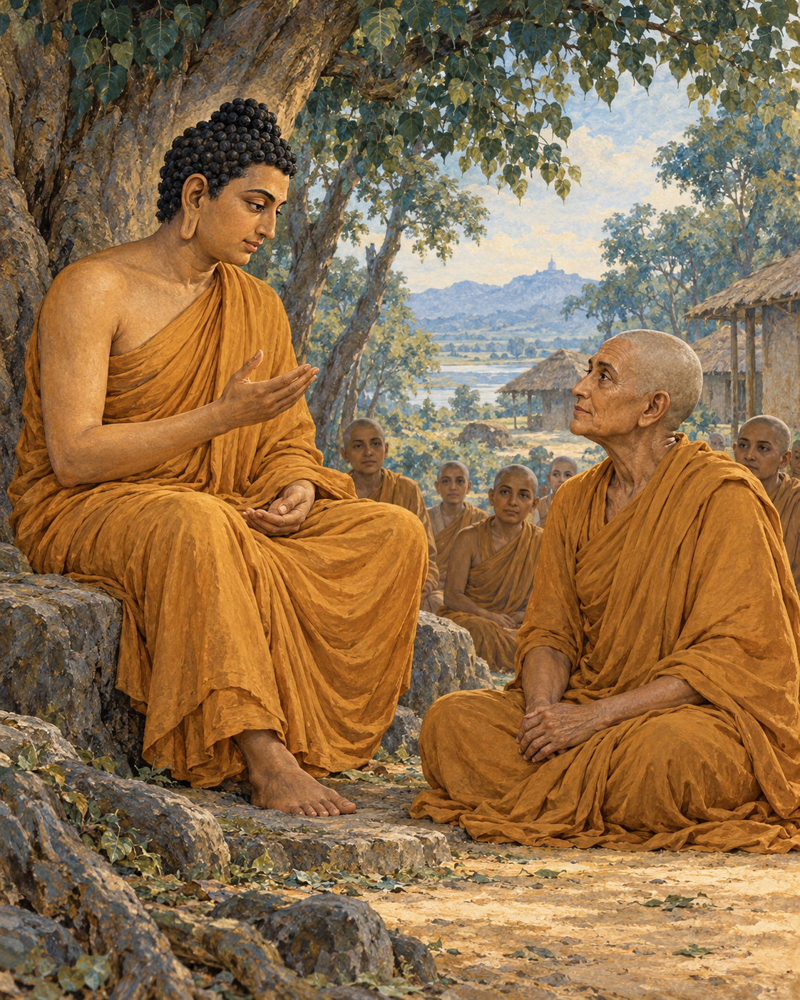

# 22. Eight Measures of Freedom

Gotami did not ask for a teaching that would occupy an afternoon. She asked for one that could accompany her into solitude.

The Buddha was staying near Vesali, in the hall with the peaked roof in the Great Wood. Mahapajapati Gotami came to him, bowed, and stood respectfully nearby. Her request was brief: would he give her an instruction concise enough to remember, something she could put to work while living apart, attentive and determined?

She was not asking to be entertained by wisdom. She wanted a way to practise when the teacher was no longer sitting in front of her.

The answer gave her a means of recognition. Certain qualities, the Buddha explained, lead in one direction; others lead in its opposite. She could learn to distinguish his teaching by the direction in which it carried a life.

Did a practice intensify craving, or help craving loosen? Did it fasten the mind more tightly to its bonds, or make release possible? Did it encourage further accumulation, or a willingness to relinquish? These were not questions about the grandeur of an argument. They concerned the changes that could actually be observed in a person.

Then the instruction moved through the more familiar habits of daily living. Did the practice multiply wishes, or help someone live with fewer? Did it keep dissatisfaction alive, or cultivate contentment? Did it draw a person continually into a crowd, or support the quiet needed for understanding?

The last measures were equally practical. Did it encourage idleness, or summon energy? Did it make someone burdensome to others, or help them live with greater consideration?

Eight pairs; eight ways of finding one's bearings.

What led towards craving, bondage, accumulation, multiplying wants, discontent, crowding, laziness, and burdening others was not the teaching and training he intended. What led in the opposite direction could be recognised as his instruction.

Gotami had asked for something short. The answer was short enough to retain and demanding enough to occupy a lifetime. It offered no shortcut around honesty. She would have to notice the results of what she cultivated, including results that contradicted her hopes for herself.

A person could appear very disciplined while becoming harder to live with. Another could collect impressive teachings while remaining unable to relinquish a minor grievance. The measures would ask what was happening beneath those appearances. A cherished practice could be examined with the same care as an unfamiliar one.

The instruction also refused to confuse freedom with collapse. Contentment stood beside energy, and simplicity beside responsibility. To want less did not mean to stop making an effort. To seek seclusion did not mean making other people carry every practical difficulty. The qualities belonged together, checking one another against easy misunderstandings.

The brief canonical account does not describe Gotami's next hour. It does not tell us which of the eight measures first exposed a habit she wished to change. We need not invent such a moment to understand what she received.

She had come seeking guidance for life away from the teacher. She was given questions she could bring to any action, any instruction, any claim of spiritual progress. Even in solitude, she would not have to judge the path by its name alone. She could look at where it was taking her.

## Wisdom to Remember

Judge a practice by what it cultivates in a life: less grasping, greater care, and sustained effort towards freedom.

## A Reflection for Today

Choose one of the eight measures for the coming week. Notice, without self-punishment, whether a familiar habit increases discontent or makes enough feel possible. Make one practical adjustment and observe its effects.

## Source Note

Original retelling of **AN 8.53, Saṅkhitta Sutta**, also titled *Gotamī Sutta*: [SuttaCentral](https://suttacentral.net/an8.53). Pali canon; Theravada transmission; canonical instruction to Mahapajapati Gotami. The eight contrasts are paraphrased. The fourth is rendered here as many wishes/few wishes; English translations differ in phrasing. No ordination controversy or later biography is imported into this short encounter. Reflective examples are original commentary, not reported events. No canonical dialogue is reproduced verbatim.
