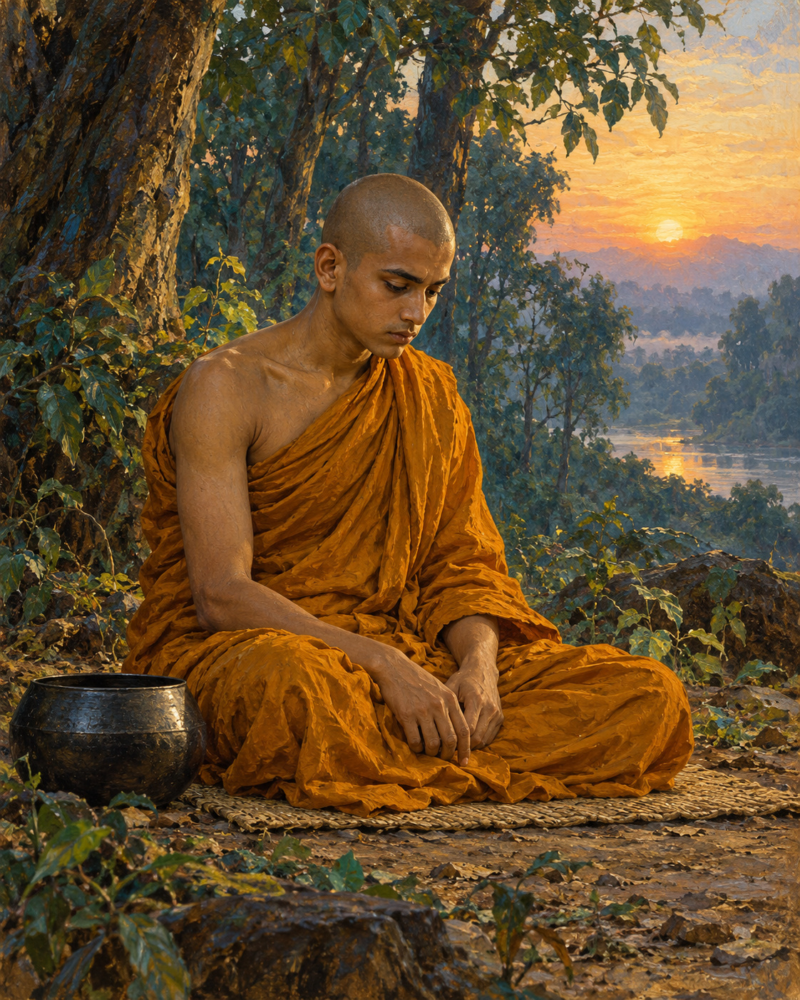

# 23. Nanda Comes Home to Himself

Nanda had left home, but a moment at the doorway kept following him.

He remembered a young Sakyan woman looking up while her hair was only partly arranged. She had asked him to return soon. In the monastery, among men who had chosen renunciation, he continued returning to that unfinished moment instead. His body had come to the grove; his longing had remained at home.

At last he told other monks that he could no longer endure the training. He intended to leave.

The news reached the Buddha, who summoned him and asked what troubled him. Nanda answered without concealing the cause. He missed the woman and could not settle into the life he had undertaken.

At this point the canonical account enters the world of religious marvel. It tells how the Buddha took Nanda by the arm and brought him to the heaven of the Thirty-three. This is the text's sacred narrative, not a journey that historical research can establish.

There Nanda saw celestial women whose beauty overwhelmed the memory he had cherished. Asked to compare them with the woman at home, he answered with a harshness that exposed how quickly desire could abandon its object. The person who had seemed incomparable a moment before was suddenly dismissed. His longing had not become kinder or wiser. It had merely found something more dazzling.

The Buddha assured him of these celestial companions, and Nanda agreed to persevere in the training. A heavenly reward now seemed sufficient reason to remain a monk.

When they returned, the other monks learned of the arrangement. They mocked him as someone working for wages, someone whose religious life had been bought. Their ridicule stung. The account does not require us to imitate it, or to believe that humiliation is always helpful. It records the discomfort that finally sent Nanda into solitude.

Alone, he applied himself with care and determination. Here the story changes its scale. Celestial splendour recedes; the work is the work of attending, understanding, and relinquishing. Nanda no longer appears before us as an admirer bargaining for possession. The text describes him practising until he attained arahantship: freedom from the defilements and from the bondage of further rebirth.

His transformation was not the satisfaction of his earlier bargain. It was release from needing the bargain at all.

The account says that a deity brought news of Nanda's attainment to the Buddha, who also knew it directly. When morning came, Nanda visited him. He no longer wanted to hold the Buddha to the promise of celestial companions. The undertaking could be set aside.

The Buddha explained that it had already ceased to bind him when Nanda's mind became free of clinging.

The remembered doorway had once seemed to contain everything Nanda wanted. Heaven had then seemed to contain still more. Each prospect had offered happiness as something to obtain, and each had made the present life into a means of reaching somewhere else.

Now there was no further demand to present. The young woman did not need to become less beautiful; heaven did not need to become less splendid. Nanda's freedom lay in the ending of the grasping that had made every beauty into a promise he had to collect.

He had returned to the teacher without asking for anything.

## Wisdom to Remember

A change of desire is not yet freedom from desire. The deeper change is learning to release the demand to possess.

## A Reflection for Today

Notice one reward that seems to justify postponing your life. Ask what kind of care or meaningful effort remains worthwhile even if that reward never arrives. Let this be an inquiry, not a judgement against ordinary affection.

## Source Note

Original retelling of **Udāna 3.2, Nanda Sutta**: [SuttaCentral](https://suttacentral.net/ud3.2). Pali canon; Theravada transmission; canonical religious narrative containing supernatural travel, celestial beings, and a report of arahantship. These elements are not presented as independently verified history. The text's objectification of women and the monks' mockery are acknowledged without endorsing them; its degrading comparison is not reproduced. Psychological transitions and narrative emphasis are editorial. No modern translation or purported verbatim historical dialogue is reproduced.
