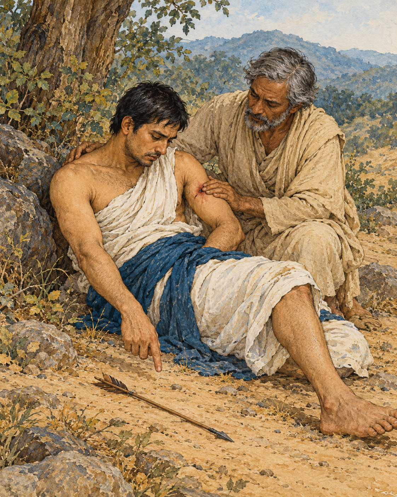

# 24. The Second Arrow

The first arrow had already struck. The question was whether another would follow it.

To explain the difference between an untrained mind and a mind instructed in the path, the Buddha asked his listeners to consider something they shared. Both experienced pleasant feelings. Both experienced painful feelings. Both knew feelings that were neither especially pleasant nor painful. Learning the teaching did not give a person a different kind of body, sealed against discomfort.

Where, then, did the difference lie?

He offered the image of someone wounded by an arrow, then struck by a second. The second wound did not heal the first. It added another pain to the one already present.

So it could be with bodily suffering. Someone experiencing physical pain might become overwhelmed by grief, agitation, and resistance. The body hurt; the mind then suffered over the hurt. What had begun as one affliction acquired another, and the person had to bear both.

This was a simile, not the report of an injured stranger brought before the Buddha. Its force came from the simplicity of its picture. No listener needed to know the name of the wounded person to recognise how readily distress could multiply.

The teaching went further than asking someone to endure a difficult sensation. When pain arrived, an untrained person resisted it. Seeking escape, they might reach for sensual pleasure because they knew no other way out. A brief relief could then become another attachment. The mind moved between refusing what it disliked and clutching what it hoped would rescue it.

Even neutral feeling could remain misunderstood. Without clear attention, the ordinary texture of experience passed unexamined, leaving ignorance in place. Pleasant, painful, and neutral feelings could all become occasions for bondage when they were met without understanding.

The trained disciple still felt the first arrow. Physical pain remained physical pain. But the disciple did not build the same additional suffering around it. Rather than being carried entirely into resistance or a desperate search for pleasure, the mind understood feeling more clearly: its arising, its passing, its attraction, its danger, and the possibility of release.

The distinction was not between a person who felt and a person who had become numb. It was between different ways of knowing what was felt.

Imagine, within the simile, how much care the first wound already required. It needed to be noticed rather than denied. Adding another arrow could only make that work more difficult. In the same way, attention to pain was not a refusal of help. The teaching concerned the mind's relationship to suffering, not an instruction to leave a wound untreated.

The Buddha's comparison did not demand that a beginner possess the steadiness of a fully trained disciple immediately. It disclosed what the training was for. A person could begin to recognise the movement from pain into resistance, from resistance into grasping, and learn not to follow every movement as though it were inevitable.

The first arrow might be beyond recall. It had happened; it hurt. Yet the teaching allowed a possibility beside the hurt: the mind need not always add to what the body was already carrying.

There was still something to learn, even there.

## Wisdom to Remember

Pain deserves care. Understanding can gradually reduce the suffering added by resistance and clinging.

## A Reflection for Today

During a manageable discomfort, gently distinguish the sensation from the thoughts gathering around it. Seek appropriate care and support. This practice is not a test of character, and distress, trauma, or illness is never evidence of spiritual failure.

## Source Note

Original retelling and exposition of **SN 36.6, Sallattha Sutta**, sections 1–4: [SuttaCentral](https://suttacentral.net/sn36.6). Pali canon; Theravada transmission; canonical teaching with an arrow simile, not a historical injury narrative. The surrounding imagined scene and contemporary cautions are editorial. The text contrasts bodily pain with added mental distress and examines attachment to all three kinds of feeling. It is not a medical claim or a guarantee of pain relief. No verbatim canonical dialogue is used.
