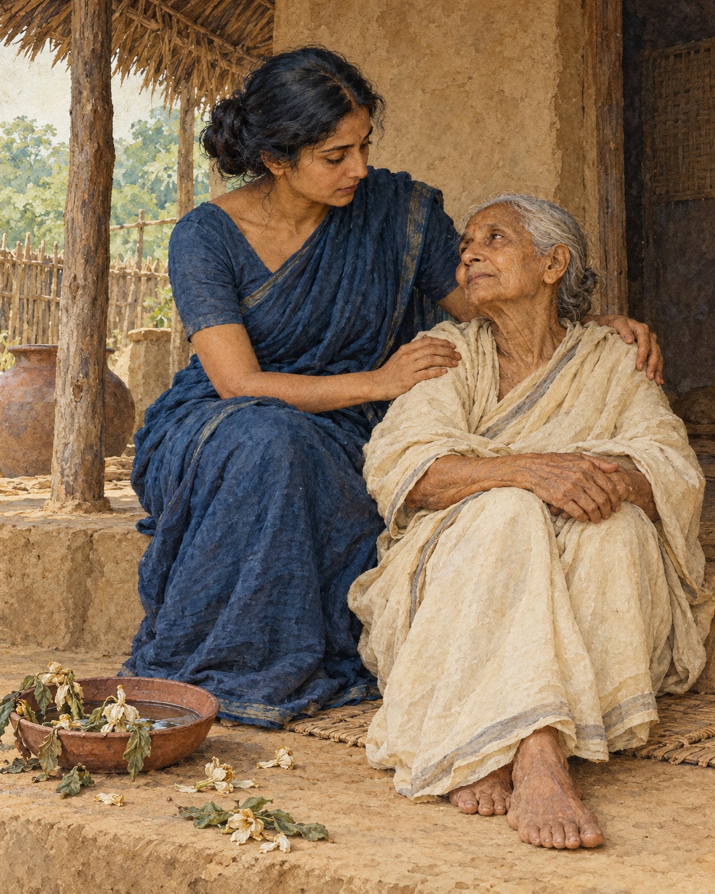

# 26. Five Things to Remember

The teaching was for women and men, for people with households and people who had left them. No one had to wait for a particular robe, age, or station in life before beginning.

The Buddha set out five matters to remember often. They concerned things so familiar that a person might pass years without looking at them steadily: ageing, illness, death, separation, and the consequences of action.

A young person could know that old age existed while living as though it belonged permanently to somebody else. Someone in good health could see sickness everywhere and still feel inwardly exempt. A person surrounded by the business of a full day could acknowledge death in principle while assuming there would always be time later to mend what mattered.

The first three recollections brought those distant possibilities closer. The body was subject to ageing and illness. Life would end. These were not punishments singled out for an unfortunate few. They belonged to the conditions of being alive.

The fourth recollection concerned everything held dear. Whatever was loved would be subject to separation and change. Affection could not make people, places, or possessions permanent. Remembering this was meant to weaken the grasping that could turn love into harmful conduct, rather than to make love itself impossible.

The fifth concerned responsibility. A person would inherit the consequences of their actions. Choices made through body, speech, and mind were not weightless simply because the moment of making them had passed.

Together, the recollections challenged several kinds of carelessness. Pride in youth could make another person's frailty seem contemptible. Pride in health could encourage recklessness or indifference. Confidence in continued life could make cruelty appear affordable. Attachment could justify wrongdoing in the name of protecting what was loved. Forgetting the consequences of action could make all these habits easier to repeat.

The Buddha described regular recollection as a way to diminish such conduct, even where it had not yet been completely abandoned. There was room in the instruction for gradual change. A person could begin where they were, without pretending to possess a wisdom they had only just encountered.

Then the contemplation widened. The disciple was to recognise that these conditions were not merely personal. Other beings too were subject to ageing, sickness, death, separation, and the results of their actions. What could first sound like an inventory of private vulnerability became a recognition of shared existence.

The frail person on the road was no longer evidence of a fate reserved for strangers. The neighbour grieving a separation was not inhabiting an entirely different world. The same uncertainty ran through every household, including one's own.

This recognition could support the development of the path. The text places the recollections within the work of loosening the bonds that keep suffering alive. They were not offered simply as sombre thoughts to carry through the day.

Nor did remembering death require knowing its date. The uncertainty was itself enough to give weight to the present choice: whether to speak truthfully, whether to repair harm, whether to show care while care could still be received.

There was much that a person could not keep. There was still much they could do. The five recollections brought those two truths into the same field of attention.

## Wisdom to Remember

What is fragile deserves care. What we choose deserves attention.

## A Reflection for Today

Read the five subjects slowly, stopping if the exercise becomes overwhelming. Choose one act of care that follows naturally: contact someone, arrange needed support, or correct an unkind word. Reflection becomes useful through the life it helps you live.

## Source Note

Original literary exposition of **AN 5.57, Upajjhaṭṭhāna Sutta**, especially sections 1–7 and the succeeding universal recollections: [SuttaCentral](https://suttacentral.net/an5.57). Pali canon; Theravada transmission; canonical instruction, not a biographical episode. The illustrative everyday situations are original applications, not ancient reported events. Kamma here means morally consequential action; this retelling does not claim that every illness or misfortune results from a person's past wrongdoing. No modern translation is quoted.
