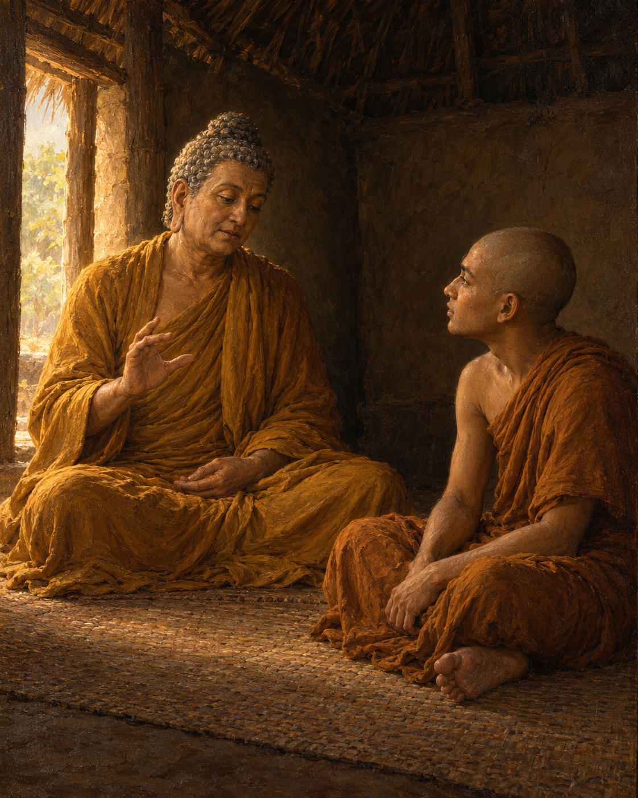

# 28. The Lute String

Sona had given the practice his energy. He could not understand why freedom had not followed.

He was staying in the Cool Grove near Rajagaha, while the Buddha was on the nearby Vulture's Peak. In solitude, a discouraging thought took shape. He counted himself among the most energetic disciples, yet his mind was still not released from clinging. His family had wealth. Perhaps he should give up the monastic training, return home, enjoy that wealth, and support good works as a layperson.

The thought was not simply a wish for comfort. It contained the exhaustion of someone who had tried hard and could no longer see what the effort was accomplishing.

The canonical narrative says that the Buddha knew Sona's thoughts and appeared before him through extraordinary power. Such a meeting belongs to the text's religious world; its miraculous manner is not something a modern historian can verify.

Once they were seated, the Buddha asked Sona about his intention to leave. Sona acknowledged it. The teacher then turned to something his disciple already understood: music.

Before becoming a monk, Sona had been skilled with a stringed instrument. What happened, the Buddha asked, when its strings were drawn too tight? Could it be played well? Sona knew that it could not. And what happened when the strings were too loose? That, too, spoiled the instrument's capacity to sound properly.

But when the tension was adjusted, neither excessive nor insufficient, the instrument could be played.

Here was a form of knowledge that did not depend on guessing what the teacher wanted to hear. Sona had learned it through his own hands and ears. Pulling harder was not always an improvement. Releasing all tension was not a solution either. Skilled attention found the condition in which the work became possible.

The Buddha applied the comparison to effort. Too much force could produce agitation. Too little could lead to idleness. Sona was to establish an appropriate balance, bringing the faculties into harmony and recognising what the situation required.

He did not need to abandon the path because the one way he had been pushing along it had proved unfruitful. He needed to learn another quality of effort.

Sona took up the instruction. Living apart, attentive and resolved, he developed the balance the Buddha had described. The discourse reports that he attained arahantship, the goal of the monastic path. His practice had not ended with discouragement, nor had it succeeded through escalating the same strain.

Afterwards he visited the Buddha and spoke about the qualities to which a liberated person was devoted: relinquishment, seclusion, harmlessness, the ending of craving and grasping, and a mind free from confusion. He explained these as expressions of release, rather than performances undertaken to satisfy other people's expectations.

The musician's understanding had helped him hear an error in his approach. His difficulty had seemed to demand either more force or complete departure. The teaching opened a third possibility: responsive, well-adjusted practice.

A string needed enough tension to sound. It did not need to suffer every possible tightening. Sona's renewed effort became fruitful when it was guided by understanding, and he no longer had to mistake the amount of strain for the measure of his sincerity.

## Wisdom to Remember

Wise effort responds to conditions. Persistence becomes more useful when it learns balance.

## A Reflection for Today

Consider one task in which harder effort is producing only agitation. Adjust one condition: the pace, the length of a session, the support available, or the time for recovery. Observe the effect before deciding that you must either force yourself further or give up.

## Source Note

Original retelling of **AN 6.55, Soṇa Sutta**, especially sections 1–10: [SuttaCentral](https://suttacentral.net/an6.55). Pali canon; Theravada transmission; canonical religious narrative and teaching. The Pali *vīṇā* refers to an ancient stringed instrument, often translated as lute or harp; the precise construction is not fixed here. The instrument is recalled in conversation, not stated to be physically present. Any illustration of it is a visual metaphor. The Buddha's extraordinary arrival is identified as a textual religious claim; no verbatim dialogue is used.
