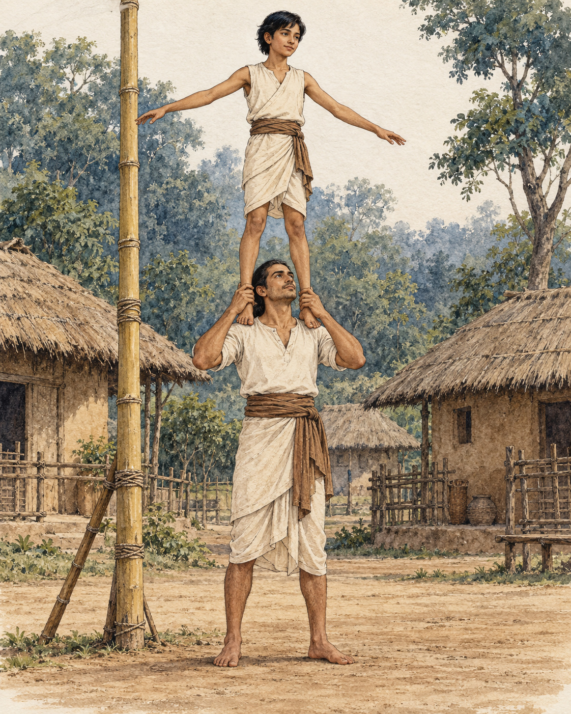

# 29. The Acrobats' Balance

High above the ground, good intentions were not enough. Each movement had to be steady.

While staying near Sedaka, in the country of the Sumbhas, the Buddha told his monks about a pole acrobat and an apprentice named Medakathalika. The teacher had set up a bamboo pole and asked the apprentice to climb it, taking a position on his shoulders. The apprentice obeyed.

The performance required both skill and trust. They hoped to display their craft, receive payment, and return safely to the ground. A successful act would not be measured only by whether the spectators were impressed. Both performers needed to come down unharmed.

The teacher proposed a plan. The apprentice should watch over him, while he watched over the apprentice. In this way, he thought, each could protect the other and the performance would succeed.

The answer came from above. The apprentice disagreed. The teacher should attend to himself, and the apprentice would do the same. By each taking proper care of their own part, they could perform skilfully and descend in safety.

The Buddha endorsed the apprentice's understanding.

The tale is brief, but it turns on a precise distinction. If the teacher failed to maintain his own balance while anxiously monitoring the person overhead, his concern would not prevent a fall. If the apprentice became absorbed in the teacher's movements and neglected their own footing, the danger would increase for both. Their responsibility to each other included responsibility for the work only each could do.

The correction did not make the performers independent. They were plainly sharing the same risk. It explained how each could contribute to the other's safety within that dependence.

The Buddha then brought the image into the practice of mindfulness. A person wishing to protect themselves should cultivate it. A person wishing to protect others should cultivate it too. Care of oneself and care of others could support each other, rather than standing as rival obligations.

He explained both directions. Through developing and practising mindfulness, a person protected others by attending to themselves. Through patience, harmlessness, loving-kindness, and sympathy, a person protected themselves by attending to others.

The second direction mattered as much as the first. The teaching did not end with the apprentice's insistence on personal steadiness. It also named the qualities with which one person should meet another. Someone could not claim to be wisely protecting themselves while using that claim to justify cruelty or neglect.

The acrobats needed a balance that could be enacted, not merely admired. In the same way, mindfulness had to become practice, and concern for others had to become patience and care. Neither side of the teaching could safely be left to intention alone.

The text does not tell us how many spectators gathered, how much the performers earned, or what praise followed their descent. It gives the moment before those outcomes, when a teacher learned something useful from an apprentice.

For a little while, their whole livelihood depended on getting that understanding right. Each had a task the other could not perform on their behalf. Each also had a life the other could help to protect. The steadiness that served one would serve them both.

## Wisdom to Remember

Taking responsibility for your own conduct can protect others. Patience and kindness towards others can also protect you.

## A Reflection for Today

In a demanding relationship, identify your own part clearly: your attention, boundaries, speech, or preparation. Attend to that work while remaining kind to the other person. You cannot control every outcome, and you need not carry responsibility for another person's harmful choices.

## Source Note

Original retelling of **SN 47.19, Sedaka Sutta**, sections 1–3: [SuttaCentral](https://suttacentral.net/sn47.19). Pali canon; Theravada transmission; canonical illustrative tale embedded in a teaching on mindfulness and mutual protection. Medakathalika's gender differs across English interpretations; this retelling uses “the apprentice” without deciding it. The exact pole arrangement is difficult to reconstruct, so the illustration is interpretive. The tale is not offered as an independently documented performance. No direct dialogue or modern translation is quoted.
