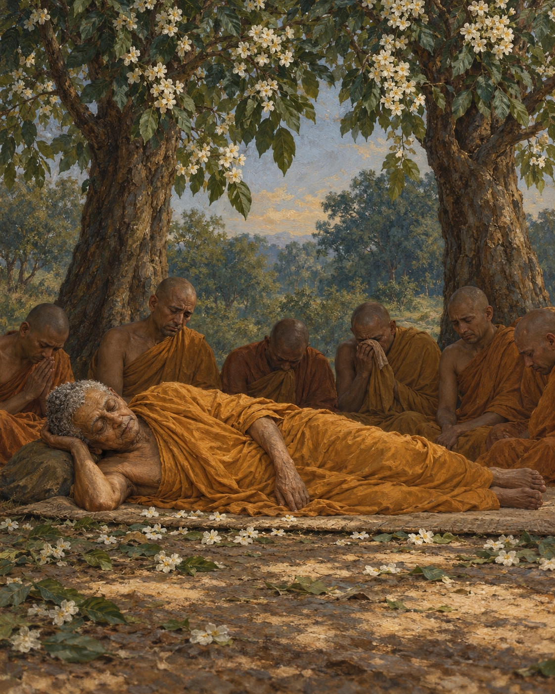

# 30. The Last Journey

The journey had become a succession of places where an old man needed to rest.

The great discourse of the Buddha's final passing follows him through towns and groves, meetings and instructions. Within its long sacred account, the body of the teacher becomes unmistakably frail. He experiences illness and pain. He needs water. A folded robe makes a place to sit beside the road.

Ananda attends him. The work of companionship is practical: arranging a resting place, answering a request, remaining near. The teacher who has guided so many people is not portrayed as beyond the body's need for help.

After accepting a meal from Cunda, the Buddha becomes gravely ill and continues towards Kusinara. Later he thinks of the donor, who might be made to feel responsible for what followed. He instructs Ananda to reassure Cunda, describing the offering as especially fortunate. Even amid his own weakness, he makes provision for another person's peace of mind.

The account does not allow us to identify the disputed dish with certainty or to diagnose the illness across the centuries. Its human emphasis is clearer: kindness must not be turned into an occasion for needless remorse.

At last the travellers reach the sal grove of the Mallas, near Kusinara. Ananda prepares a resting place between two trees. The Buddha lies on his right side, mindful and aware.

The text surrounds this moment with sacred marvels: flowers blooming out of season, heavenly offerings and music. It also directs attention beyond ceremonial honour. Those who practise according to the teaching, the Buddha explains, honour him in the fullest way. What matters is not only what falls from the branches, but how those who remain will live.

Ananda withdraws and weeps. He has not completed his own training, and the teacher who has shown him such kindness is about to die. When the Buddha learns where he has gone, he calls for him.

He reminds Ananda that separation from what is dear cannot be prevented. But he does not answer his grief with an abstract lesson alone. He acknowledges the devoted care Ananda has given him through body, speech, and mind, and encourages him to continue diligently. The attendant's years of service are seen and named.

There are still people to receive and questions to answer. The discourse describes the Buddha allowing a final inquirer to approach, and later offering the assembled monks opportunities to raise any remaining uncertainty. Even near the end, teaching remains an act of attention to the people before him.

He tells Ananda that the teaching and discipline will guide the community after his passing. His final instruction reminds the monks that conditioned things are subject to dissolution and urges diligent practice.

Then, in the account's description, he enters and emerges from successive meditative states before his final passing. Some disciples grieve openly. Others remain composed in their understanding of impermanence. The text preserves both responses beside the same loss.

There is no promise that those who loved him will never feel the absence. What remains is the path he taught, and the possibility of walking it. Ananda will still have work to do. So will the community. The last journey reaches its end, and the care it has taught must continue through other hands.

## Wisdom to Remember

Impermanence makes care urgent. A teaching is honoured through the life it helps us practise.

## A Reflection for Today

Think of someone whose guidance has helped you. Choose one quality you can carry forward through action. If you are grieving, let remembrance include both gratitude and sorrow; neither has to cancel the other.

## Source Note

Original selective retelling of **DN 16, Mahāparinibbāna Sutta**, especially the final meal and reassurance to Cunda, the sal grove, Ananda’s grief, and final instructions and passing: [SuttaCentral](https://suttacentral.net/dn16). In the [Vajira/Story reference edition](https://www.accesstoinsight.org/tipitaka/dn/dn.16.1-6.vaji.html), these occur at 4.14–25, 4.56, 5.1–6, 5.33–35, 5.53–68, and 6.1–17; section numbering differs by edition. Pali canon; Theravada transmission; canonical sacred biography with supernatural elements, preserved in a text shaped through transmission rather than a modern eyewitness record. The composition of *sūkaramaddava*, the final meal, is disputed; no identification or medical diagnosis is asserted. Final instructions are paraphrases, not quotations. Scene selection and connective prose are original editorial work.
